# Evidencias – Lab Escalamiento en Azure (Parte 2: Escalabilidad horizontal)

ARSW – Escuela Colombiana de Ingeniería Julio Garavito
Responsable Parte 2: Juan Manuel López Barrera

> Infraestructura en **Central US**, grupo de recursos `SCALABILITY_LAB`.
> Nodos: VMs **Standard_D2s_v3** (2 vCPU / 8 GB). La suscripción Azure for Students tiene un tope de **6 vCPU por región** y la serie B (B1ls, B1s, B2ats_v2) no está disponible para la suscripción en Central US, así que el máximo posible son **3 nodos**.
> Además la cuenta tiene tope de **3 IPs públicas por región** y de **4 vCPU para la familia DSv3**, por eso VM2 quedó como **Standard_D2s_v4** (mismas 2 vCPU / 8 GB) y VM3 terminó solo con IP privada.

---

## 1. Creación de la Virtual Network – Datos básicos

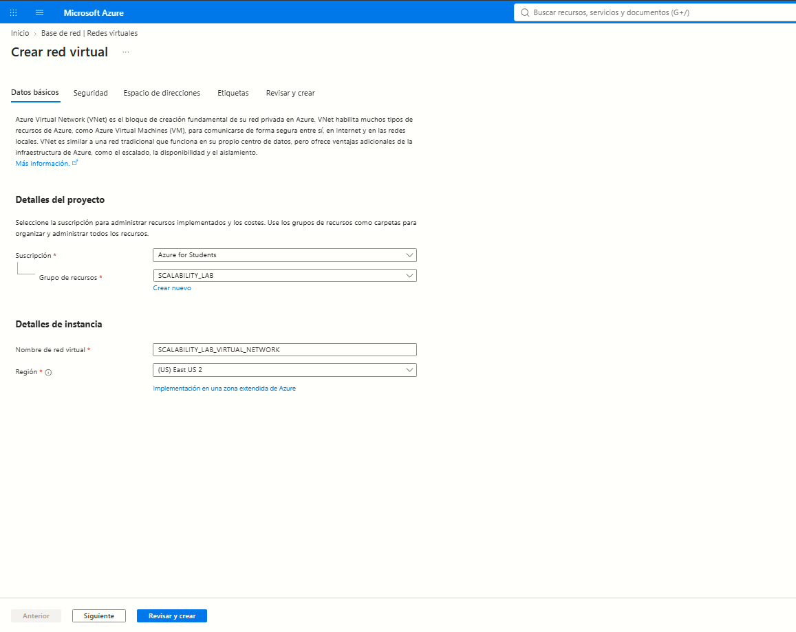

Arrancamos creando la red virtual donde van a vivir todas las VMs. La metimos en la suscripción **Azure for Students**, dentro del grupo de recursos nuevo `SCALABILITY_LAB`, con el nombre `SCALABILITY_LAB_VIRTUAL_NETWORK` y en la región **Central US**. Primero intentamos East US 2, pero la política de Azure for Students la bloquea ("policy violation"), así que nos pasamos a Central US, que sí está permitida y tiene zonas de disponibilidad (las necesitamos para repartir las VMs en zonas 1, 2 y 3). Todo lo que creemos de aquí en adelante (balanceador, IPs, VMs) tiene que quedar en esta misma región.

## 2. Virtual Network – Espacio de direcciones y subred

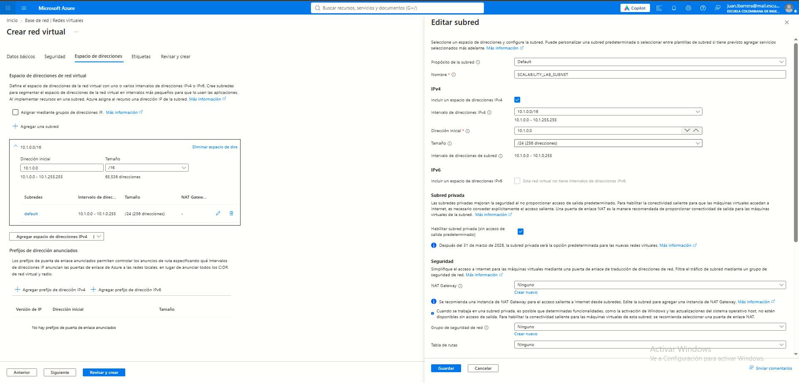

Aquí se define el "terreno" de IPs privadas de la red. El **address space** de la VNet quedó en `10.1.0.0/16`, o sea desde 10.1.0.0 hasta 10.1.255.255 (65.536 direcciones). Dentro de ese espacio creamos la subred `SCALABILITY_LAB_SUBNET` con el **address range** `10.1.0.0/24` (10.1.0.0 – 10.1.0.255, 256 direcciones), que es donde Azure les va a ir asignando IP privada a las VMs. Básicamente el /16 es todo el lote y el /24 es un pedacito de ese lote reservado para nuestras máquinas. Sin NAT Gateway ni tabla de rutas, porque cada VM va a tener su propia IP pública.

## 3. Virtual Network – Revisar y crear

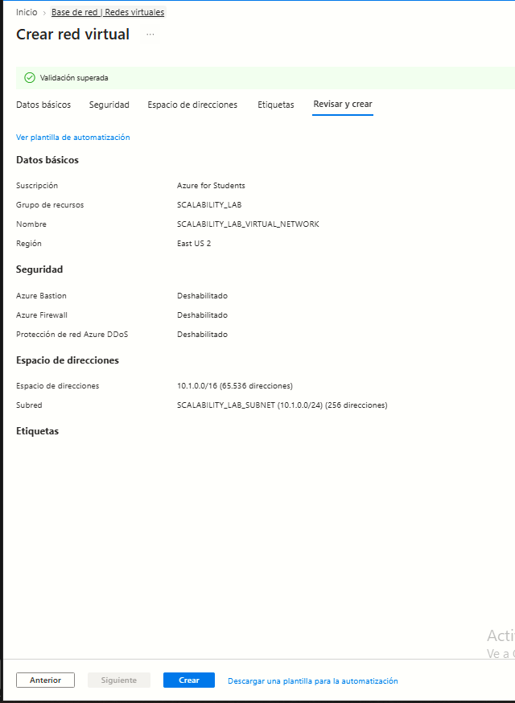

Resumen final antes de crear la VNet, con la validación superada. Se confirma todo lo configurado: Azure for Students, `SCALABILITY_LAB`, espacio `10.1.0.0/16` y subred `SCALABILITY_LAB_SUBNET` (`10.1.0.0/24`). Bastion, Firewall y la protección DDoS quedaron **deshabilitados** a propósito, porque no los necesitamos para el lab y los tres cobran aparte.

## 4. Load Balancer – Datos básicos

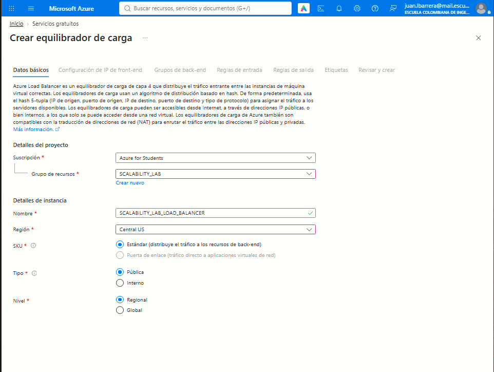

Ahora sí la pieza clave de la escalabilidad horizontal: el balanceador. Lo creamos como `SCALABILITY_LAB_LOAD_BALANCER` en el mismo grupo de recursos y en **Central US**, igual que la VNet. Lo importante aquí son tres opciones:
- **SKU Estándar**: es el que reparte el tráfico entre recursos de back-end (VMs). La otra opción, "Puerta de enlace" (Gateway), es para meter appliances de red de terceros en medio del tráfico, nada que ver con lo que necesitamos. Además el SKU Básico ya fue retirado por Azure, así que Estándar es la única opción real, y ojo que es el que soporta zonas de disponibilidad.
- **Tipo Público**: porque los usuarios (newman desde nuestro PC) van a entrar desde internet. Uno *Interno* solo sería accesible desde dentro de la VNet.
- **Nivel Regional**: balancea dentro de una sola región. El *Global* sirve para repartir entre varias regiones, que no es nuestro caso.

## 5. Load Balancer – Configuración de IP de front-end

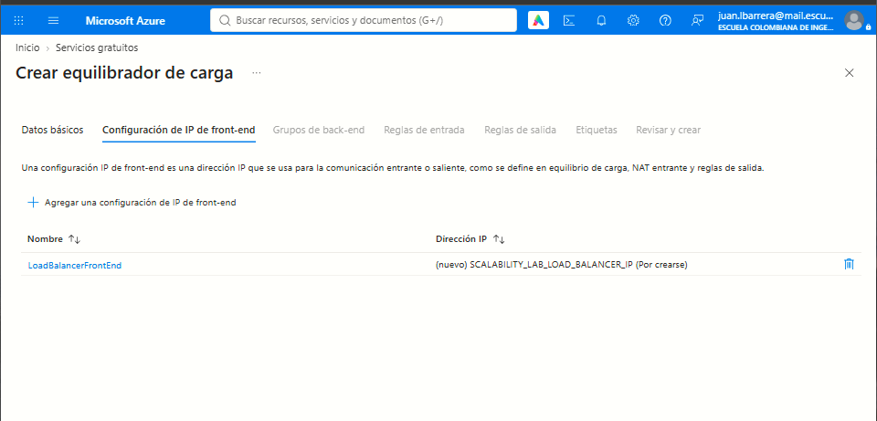

El front-end es la "puerta de entrada" del balanceador: la IP a la que le van a pegar los clientes. Creamos `LoadBalancerFrontEnd` con una IP pública nueva, `SCALABILITY_LAB_LOAD_BALANCER_IP` (IPv4, SKU Estándar, estática y **con redundancia de zona**). Que sea zone-redundant quiere decir que esa IP no vive en una sola zona de disponibilidad sino que está replicada en las tres, así que si se cae una zona completa la IP sigue respondiendo. Esto es justo lo que necesitamos porque las VMs las vamos a repartir en zonas 1, 2 y 3. El LB necesita IP pública porque es público: sin ella nadie desde internet (por ejemplo newman desde nuestro PC) podría llegarle.

## 6. Load Balancer – Grupo de back-end (Backend Pool)

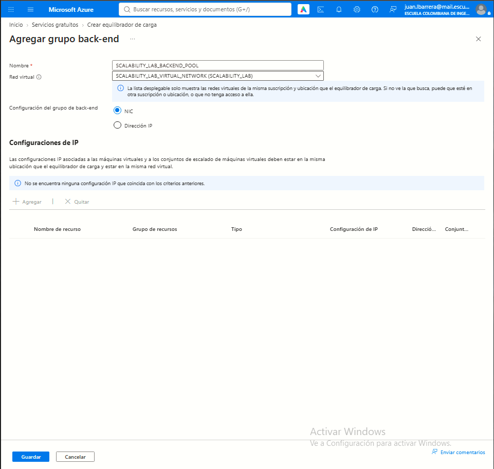

El backend pool es la lista de máquinas a las que el balanceador les va a repartir el tráfico. Lo llamamos `SCALABILITY_LAB_BACKEND_POOL`, amarrado a nuestra `SCALABILITY_LAB_VIRTUAL_NETWORK`, y configurado por **NIC** (o sea, se agregan las tarjetas de red de las VMs, no IPs sueltas). Por ahora sale vacío ("No se encuentra ninguna configuración IP") porque las VMs todavía no existen; cuando las creemos las vamos a meter a este pool desde el mismo formulario de la VM. La gracia de esto es que si mañana necesitamos más capacidad, solo agregamos otra VM al pool y el LB empieza a mandarle tráfico sin tocar nada más.

## 7. Load Balancer – Regla de equilibrio de carga + Health Probe

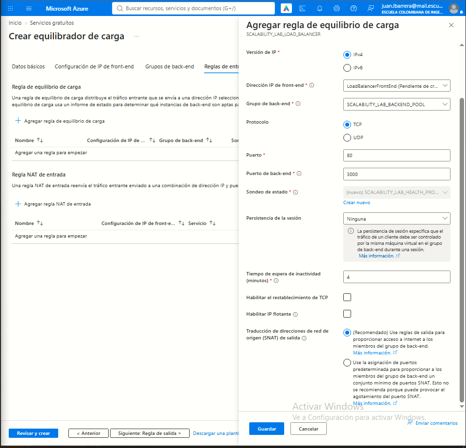

La regla es la que conecta todo: dice "lo que llegue al front-end por TCP al **puerto 80**, mándalo a alguna VM del `SCALABILITY_LAB_BACKEND_POOL` al **puerto 3000**" (que es donde escucha la FibonacciApp). Así el cliente le pega a `http://IP_DEL_LB/fibonacci/N` sin tener que poner puerto, y el LB se encarga del resto.

Además la regla usa el **health probe** `SCALABILITY_LAB_HEALTH_PROBE` (TCP al puerto 3000 cada 5 segundos). El probe es el que va "tocando la puerta" de cada VM: si una deja de contestar, el LB la saca de la rotación y deja de mandarle peticiones hasta que vuelva a responder.

Otros detalles:
- **Persistencia de sesión: Ninguna** → cada conexión nueva puede caer en cualquier VM. Es lo que queremos para repartir la carga parejo; si activáramos persistencia (por IP de cliente o IP+protocolo), todas las peticiones de newman desde nuestro PC caerían en la misma VM y perderíamos la gracia del balanceo.
- **Tiempo de inactividad: 4 min** (el default).
- **IP flotante deshabilitada**, que solo se usa en escenarios tipo clúster de SQL.
- **SNAT de salida:** la opción recomendada (reglas de salida). Igual nuestras VMs van a tener IP pública propia para salir a internet.

## 8. Load Balancer – Revisar y crear

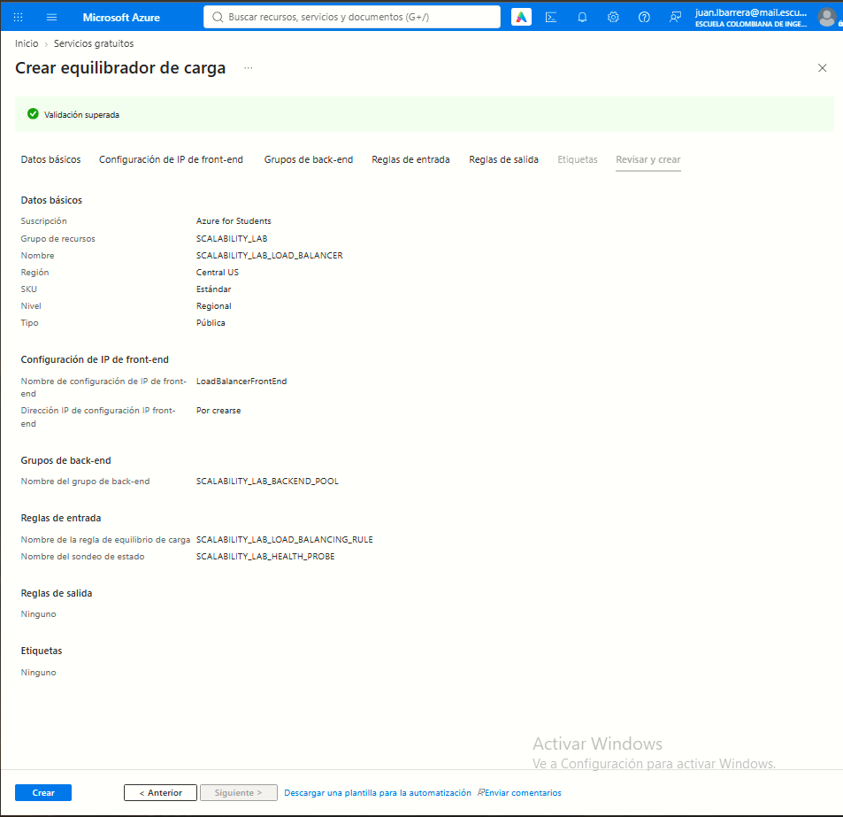

Resumen del balanceador antes de crearlo, con validación superada. Queda todo armado: `SCALABILITY_LAB_LOAD_BALANCER` (Estándar, Regional, Público, Central US), front-end `LoadBalancerFrontEnd` con su IP pública por crearse, el pool `SCALABILITY_LAB_BACKEND_POOL`, la regla `SCALABILITY_LAB_LOAD_BALANCING_RULE` y el probe `SCALABILITY_LAB_HEALTH_PROBE`. Sin reglas de salida ni etiquetas. A diferencia de la guía original (portal de 2019), donde cada pieza se creaba por separado después del LB, en el portal actual todo se arma de una vez en el mismo asistente.

## 9. VM1 – Datos básicos

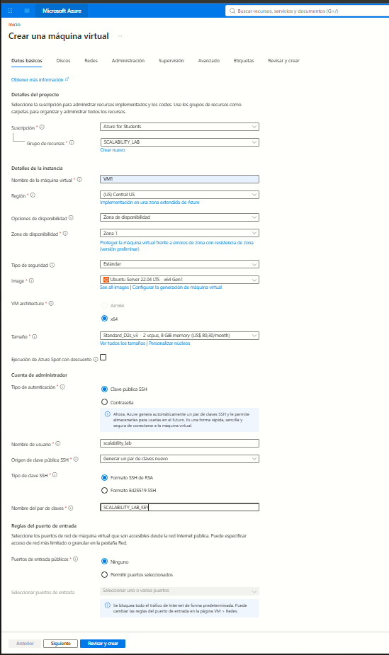

Primer nodo: `VM1`, en Central US y en la **Zona de disponibilidad 1** (VM2 va a ir en la zona 2 y VM3 en la 3, así si se cae un datacenter completo los otros dos siguen atendiendo).

Aquí nos tocó pelear un rato con Azure:
- La guía pide tamaño **B1ls**, pero en nuestra cuenta de estudiante toda la serie B (B1ls, B1s y hasta la B2ats_v2 del free tier) sale como "Tamaño no disponible" en Central US, y el buscador de "opciones implementables" no encontró ninguna región/zona donde se pudiera. Lo más barato que sí se dejaba fue **Standard_D2s_v3** (2 vCPU, 8 GB, ~US$80/mes ≈ US$0,11/hora), y como solo la vamos a tener prendida mientras hacemos las pruebas, el costo real es de centavos.
- Usamos la imagen **Ubuntu Server 22.04 LTS x64 Gen1** con **tipo de seguridad Estándar**, porque Gen1 no es compatible con "Inicio seguro" (Trusted Launch).
- Autenticación por **llave SSH** (`SCALABILITY_LAB_KEY`, la misma para todas las VMs) con el usuario `scalability_lab`, y **sin puertos públicos abiertos** aquí, porque los puertos los manejamos con el Network Security Group en la pestaña de Redes.

## 10. Network Security Group (NSG) – Reglas de entrada

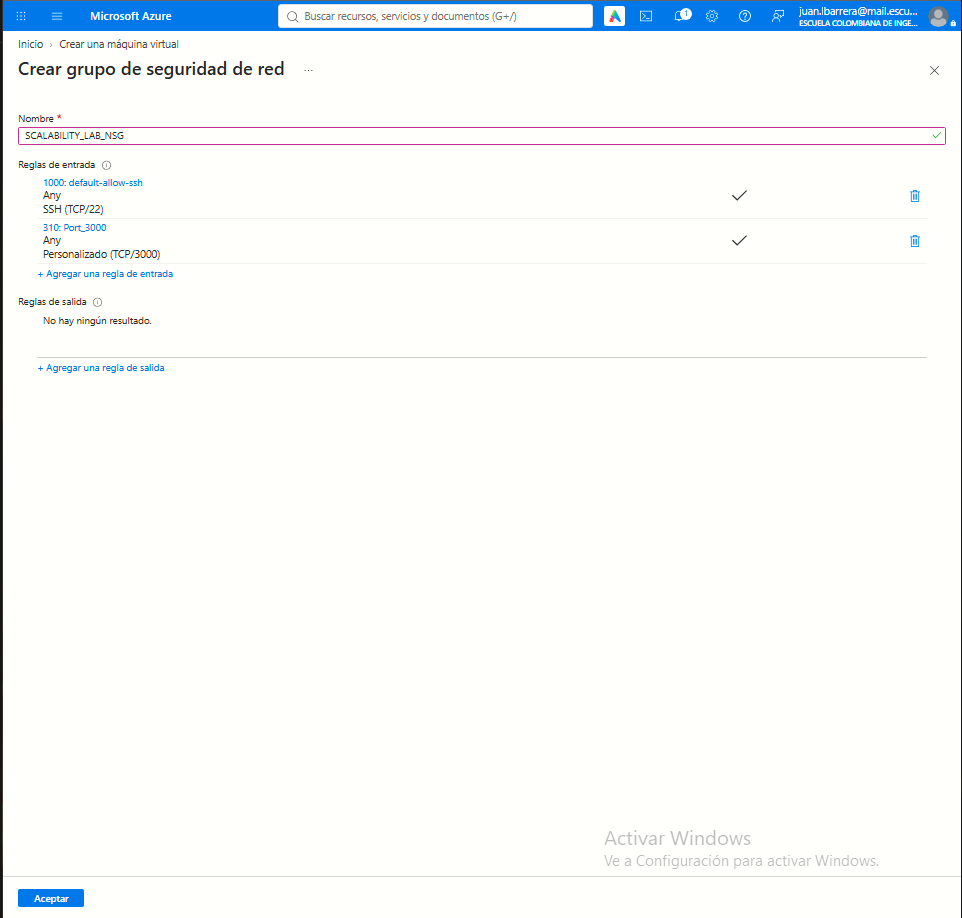

El NSG es el firewall de las VMs: define qué tráfico puede entrar y salir de la tarjeta de red. Creamos `SCALABILITY_LAB_NSG` con dos reglas de entrada:
- **1000 – default-allow-ssh (TCP/22):** para poder entrar por SSH a las VMs si toca revisar algo.
- **310 – Port_3000 (TCP/3000):** para dejar pasar las peticiones a la FibonacciApp, que escucha en el puerto 3000. Sin esta regla el NSG bloquea todo lo que no esté permitido explícitamente, y por eso el balanceador nunca le podría llegar a la app (y el health probe marcaría la VM como caída).

La prioridad funciona al revés de lo que uno pensaría: **número más bajo = se evalúa primero**. Este mismo NSG lo vamos a reutilizar en VM2 y VM3, así las reglas quedan iguales en todos los nodos sin tener que repetirlas.

## 11. VM1 – Datos personalizados (cloud-init)

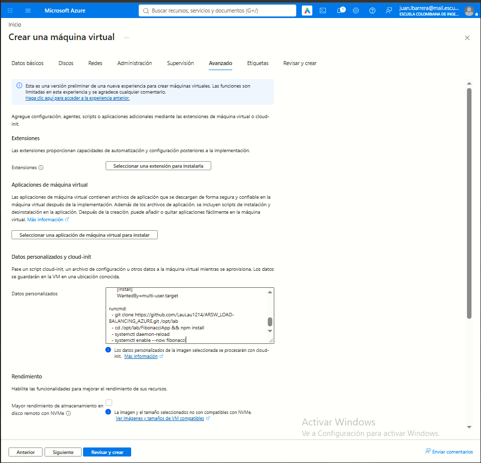

En vez de entrar por SSH a cada VM e instalar todo a mano como dice la guía (nvm, node, git clone, npm install, forever…), automatizamos la instalación con **cloud-init**: un script que Azure le pasa a la VM y que Ubuntu ejecuta solito en el primer arranque. El script (`cloud-init-fibonacci.yaml`, incluido junto a este documento):
1. Instala `git`, `nodejs` y `npm`.
2. Clona el repo del lab en `/opt/lab`.
3. Hace `npm install` dentro de `FibonacciApp`.
4. Registra la app como **servicio de systemd** (`fibonacci.service`) y lo arranca.

Usamos systemd en vez de `forever` porque además de mantener la app viva cuando se cierra la sesión SSH (que es el problema que resuelve `forever`), la vuelve a levantar sola cuando la VM se reinicia o la prendemos después de apagarla, y si el proceso se cae lo reinicia (`Restart=always`). Es justo el tipo de automatización que la guía menciona (Ansible, Terraform, etc.) pero en su versión más simple. El mismo script se pega en las 3 VMs y todas quedan idénticas.

## 12. VM1 – Revisar y crear (precio)

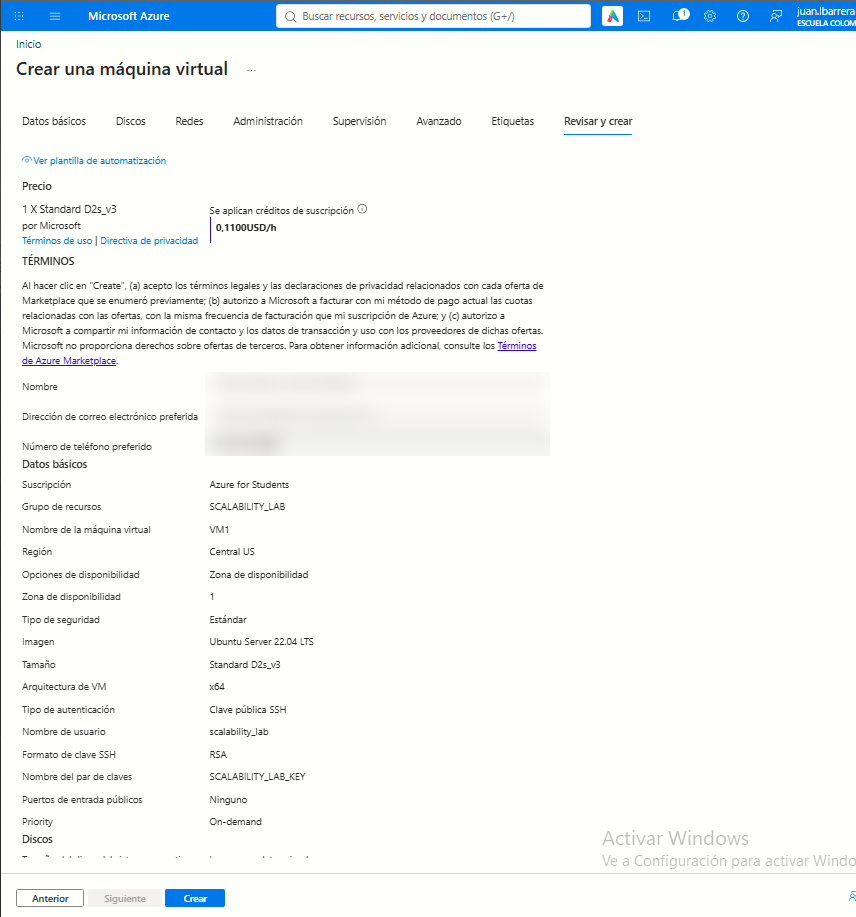

Resumen antes de crear VM1 (datos de contacto difuminados). Lo más importante es el precio: **1 × Standard D2s_v3 = 0,11 USD/hora**, que se descuenta de los créditos de Azure for Students. Por eso la idea es crear las VMs, hacer las pruebas de carga y apagarlas (Detener → desasignada) apenas terminemos; con el apagado automático configurado de respaldo. El resto confirma lo configurado: Central US, zona 1, seguridad Estándar, Ubuntu Server 22.04 LTS, llave `SCALABILITY_LAB_KEY` y sin puertos públicos (el acceso lo controla el NSG).

## 13. Prueba de la app a través del Load Balancer

Primera prueba de la infraestructura: le pegamos directo a la **IP pública del balanceador** (`48.214.164.243`), sin puerto, igual que pide la guía:
- `http://48.214.164.243/` → **Hello World**
- `http://48.214.164.243/fibonacci/6` → **The answer is 8**

Esto confirma que toda la cadena funciona de punta a punta: el LB recibe la petición por el puerto 80, la regla la reenvía al puerto 3000 de alguna VM del backend pool, el NSG la deja pasar, y la FibonacciApp (instalada sola con cloud-init y corriendo como servicio) responde. En ningún momento tuvimos que entrar por SSH a las VMs.

## 14. Prueba directa a VM3 (sin pasar por el LB)

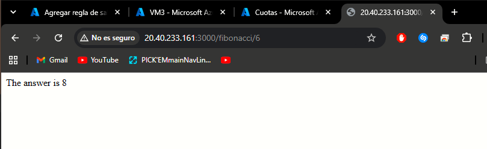

Como el balanceador manda cada petición a cualquier VM, la prueba anterior solo garantiza que *alguna* responde. Para confirmar nodo por nodo le pegamos directo a la IP pública de VM3 en el puerto de la app: `http://20.40.233.161:3000/fibonacci/6` → **The answer is 8**. Con esto sabemos que el cloud-init de VM3 terminó bien y la app quedó instalada en su disco, que era el requisito para poder quitarle la IP pública después (ver siguiente paso).

## 15. Prueba directa a VM1 (sin pasar por el LB)

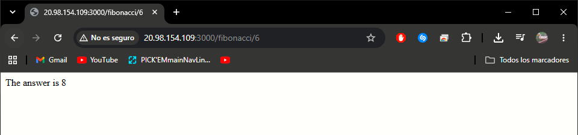

Misma prueba pero contra VM1: `http://20.98.154.109:3000/fibonacci/6` → **The answer is 8**. Con esto quedan confirmados los dos nodos que tenían IP pública, cada uno respondiendo por su cuenta en el puerto 3000. O sea que cuando el LB reparte, cualquiera de las dos que le toque va a contestar bien.

## 16. VM2 funcionando y backend pool con los 3 nodos

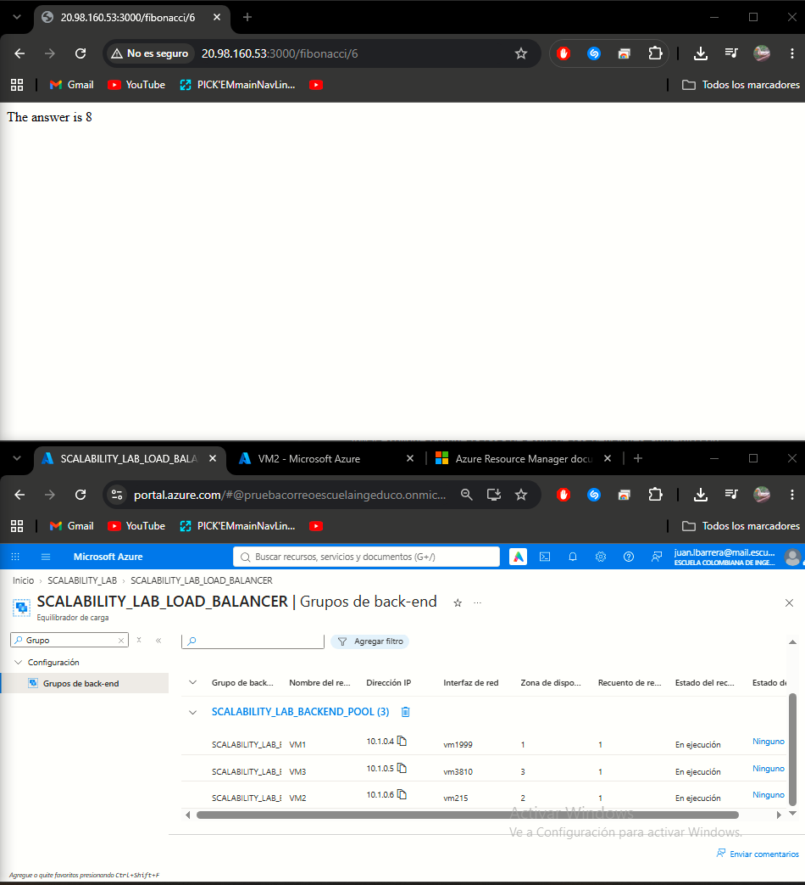

Arriba: prueba directa a VM2 (`http://20.98.160.53:3000/fibonacci/6` → **The answer is 8**), o sea que su cloud-init también terminó bien.

Abajo: el **backend pool** `SCALABILITY_LAB_BACKEND_POOL` ya tiene sus **3 nodos**, todos "En ejecución" y cada uno en una zona de disponibilidad distinta:

| VM | IP privada | Zona | Tamaño |
|---|---|---|---|
| VM1 | 10.1.0.4 | 1 | Standard_D2s_v3 |
| VM2 | 10.1.0.6 | 2 | Standard_D2s_v4 |
| VM3 | 10.1.0.5 | 3 | Standard_D2s_v3 |

Fíjense que el LB habla con las VMs por sus **IPs privadas** (10.1.0.x, dentro de la subred), no por las públicas. Por eso a VM3 le pudimos quitar la IP pública sin que dejara de recibir tráfico.

Para llegar aquí nos chocamos con dos límites más de la cuenta de estudiante:
- **Máximo 3 IPs públicas por región** (`PublicIPCountLimitReached`): con la del LB, VM1 y VM3 ya estábamos en el tope y VM2 no se podía crear. Como VM3 ya tenía la app instalada, le quitamos su IP pública (la app no necesita internet para correr, solo para instalarse) y así VM2 pudo tener la suya para descargar todo.
- **Máximo 4 vCPU en la familia DSv3**: VM1 y VM3 ya usaban esas 4, entonces VM2 se creó como **D2s_v4**, que es de otra familia pero tiene exactamente las mismas 2 vCPU y 8 GB. Para el experimento da lo mismo.

## 17. Prueba de carga con newman – 2 ejecuciones en paralelo (punto 2)

Corrimos la colección de la parte 2 contra el LB (`http://48.214.164.243/fibonacci/1000000`) dos veces al mismo tiempo, cada una con 10 iteraciones (`-n 10`). Como PowerShell no acepta el `&` del README, lo hicimos con dos ventanas de PowerShell arrancadas casi al tiempo.

| Ejecución | Peticiones | Fallidas | Tiempo promedio | Mín – Máx | Desv. est. | Duración total |
|---|---|---|---|---|---|---|
| Ventana 1 | 10 | **0** | **19,6 s** | 19,3 – 20,4 s | 277 ms | 3 min 17 s |
| Ventana 2 | 10 | **0** | **24,1 s** | 23,7 – 25,1 s | 424 ms | 4 min 2 s |
| **Total** | **20** | **0 (100 % éxito)** | | | | |

Qué se ve:
- **Cero fallos**: las 20 peticiones respondieron `200 OK` (cada respuesta pesa ~209 kB, porque el número de Fibonacci de 1.000.000 tiene más de 200.000 dígitos).
- **Tiempos muy estables** dentro de cada ventana (desviación de menos de medio segundo). Si las dos ventanas hubieran caído en la misma VM, Node (que es de un solo hilo) habría tenido que atender una petición detrás de la otra y los tiempos se habrían ido cerca del doble. Que no pase eso indica que el **balanceador mandó cada ejecución a una VM distinta** y cada una calculó tranquila sin competir por CPU.
- La diferencia entre ventanas (19,6 s vs 24,1 s) probablemente es porque cayeron en VMs de distinta generación: VM2 es D2s_v4 (procesador más nuevo) y VM1/VM3 son D2s_v3. Cada ejecución de newman reutiliza su conexión, y el LB reparte por conexión (hash de 5 tuplas), así que todas las peticiones de una misma ventana terminan en la misma VM.

## 18. Consumo de CPU de las 3 VMs después de la prueba (vista 24 h)

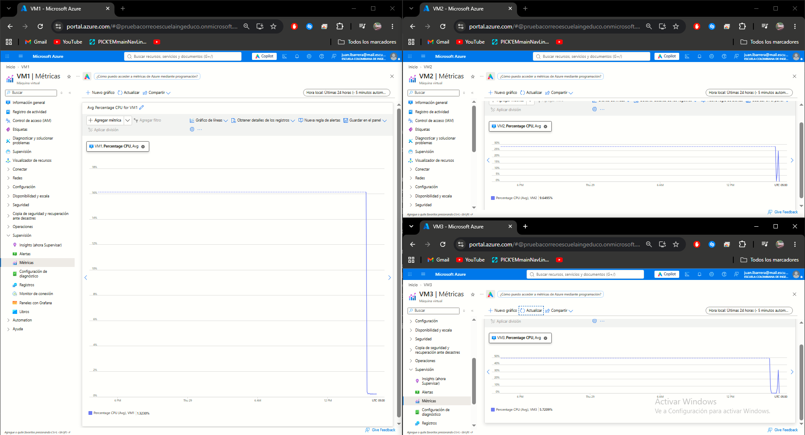

Métrica **Percentage CPU (Avg)** de cada VM (VM1 izquierda, VM2 arriba a la derecha, VM3 abajo a la derecha). La línea punteada larga es solo el tramo donde la VM todavía no existía; lo que importa es el final de cada gráfica, que es donde corrimos newman:
- **VM3** sube hasta cerca del **50 %**.
- **VM2** también tiene su pico, más bajito.
- **VM1** se queda prácticamente en **0 %**, o sea que en esta prueba no le tocó ninguna de las dos ejecuciones.

Esto cuadra con lo que vimos en newman: el LB reparte **por conexión**, cada ventana de newman abrió su conexión y cayó en una VM distinta (VM2 y VM3), y la tercera se quedó libre esperando más carga.

¿Por qué el techo es ~50 % y no 100 %? Porque cada VM tiene **2 vCPU** y Node.js ejecuta el cálculo en **un solo hilo**, así que solo puede exprimir un núcleo al 100 % → 50 % del total de la máquina. Eso también explica por qué en la Parte 1 escalar verticalmente (más vCPU en una sola máquina) no ayuda tanto: el núcleo extra se queda sin usar. Con escalabilidad horizontal, en cambio, cada petición concurrente puede caer en una máquina distinta con su propio núcleo libre.

Nota: como la gráfica está en rango de 24 h, el pico se ve aplastado y el promedio de la leyenda (VM1 1,3 %, VM2 9,6 %, VM3 5,7 %) incluye horas sin carga.

## 19. Prueba de carga con newman – 4 ejecuciones en paralelo con 3 VMs (punto 3)

La guía pide agregar una 4.ª VM y lanzar 4 newman en paralelo. **La 4.ª VM no se pudo crear** por el tope de 6 vCPU regionales de Azure for Students (3 VMs × 2 vCPU = 6, y en las regiones permitidas no hay tamaños de 1 vCPU disponibles para la suscripción). Igual corrimos las **4 ejecuciones en paralelo contra los 3 nodos**, que de hecho sirve para ver qué pasa cuando hay más carga que nodos. Las 4 ventanas se lanzaron a la vez con `Start-Process` desde PowerShell.

| Ventana | Peticiones | Fallidas | Promedio | Mín – Máx | Desv. est. | Duración |
|---|---|---|---|---|---|---|
| Arriba izq. | 10 | 1 | 19,2 s | 19,2 – 19,5 s | 99 ms | 3 min 13 s |
| Arriba der. | 10 | **3** | **31,5 s** | 21,1 – **56,6 s** | **13,2 s** | 4 min 36 s |
| Abajo izq. | 10 | 1 | **27,8 s** | 23,1 – **46,1 s** | **9,1 s** | 4 min 17 s |
| Abajo der. | 10 | 1 | 21,2 s | 21,1 – 21,6 s | 142 ms | 3 min 33 s |
| **Total** | **40** | **6** | | | | **85 % de éxito** |

Comparado con la prueba de 2 en paralelo (20/20, 100 %):
- **Dos ventanas siguen estables** (~19 y ~21 s, desviación de milisegundos): les tocó una VM para ellas solas.
- **Las otras dos se disparan**: picos de 46 y 56 s y desviaciones de 9 a 13 s. Con 4 flujos y 3 VMs, a una VM le tocó atender **dos ejecuciones al mismo tiempo**, y como Node.js es de un solo hilo, mientras calcula una petición la otra se queda esperando en fila → el tiempo casi se duplica (~21 s de cálculo + ~21-25 s de espera ≈ 46-56 s).
- **Aparecen 6 fallos `read ECONNRESET`**: el servidor cerró la conexión TCP en medio de la petición. Nuestra hipótesis es que es efecto de esa misma saturación: con el event loop de Node bloqueado ~20 s por cada cálculo, los timers de las conexiones keep-alive se disparan tarde y el servidor termina cerrando sockets justo cuando newman ya mandó la siguiente petición por ahí. Cuando una conexión se reinicia, la nueva conexión puede caer en otra VM (el LB vuelve a hacer el hash), por eso también aparece algún fallo suelto en las ventanas "estables".

**Conclusión del punto 3:** con más flujos concurrentes que nodos, la tasa de éxito cae (de 100 % a 85 %) y los tiempos se vuelven inestables, justamente porque un nodo queda compartido. Con la 4.ª VM que pide la guía, cada uno de los 4 flujos tendría su propio nodo y el comportamiento debería parecerse al de la prueba de 2 en paralelo (tiempos estables, sin fallos): **por eso la tasa de éxito aumenta al escalar horizontalmente**. Esa es la idea central: agregar nodos agrega capacidad real de atender peticiones concurrentes, cosa que una VM más grande con Node (un solo hilo) no logra.

## 20. CPU de las 3 VMs en la última hora (ambas pruebas)

Misma métrica (**Percentage CPU**) pero en rango de **última hora**, donde ya se ven claras las dos pruebas (VM1 izquierda, VM2 arriba derecha, VM3 abajo derecha):

| VM | Prueba 1 (2 en paralelo, ~4:00 p. m.) | Prueba 2 (4 en paralelo, ~4:20 p. m.) |
|---|---|---|
| VM1 | ~0 % (no le tocó) | sube a ~50 % |
| VM2 | ~50 % | ~50 % |
| VM3 | ~50 % | ~50 % |

Lo que se lee:
- **En la prueba 1** solo trabajaron VM2 y VM3, una por cada ejecución de newman, y VM1 se quedó de reserva. Confirma lo de la evidencia 17.
- **En la prueba 2** trabajan **las tres**, porque había 4 flujos para 3 nodos.
- **Ninguna pasa de ~50 %**, ni siquiera la que atendió dos ejecuciones a la vez. Es el límite de Node.js de un solo hilo en una VM de 2 vCPU: usa un núcleo al 100 % y el otro queda ocioso. La sobrecarga **no se ve como más CPU sino como más tiempo de espera** (los picos de 46-56 s y los `ECONNRESET` de la evidencia 19).

La CPU **nunca pasó del 70 %**, pero con 4 flujos **no todas las peticiones fueron respondidas** (85 % de éxito). O sea que para esta app la CPU promedio no es buen indicador de saturación; lo que manda es cuántas peticiones concurrentes hay por nodo, y la solución es tener al menos un nodo por flujo concurrente (escalar horizontalmente).

