### Escuela Colombiana de Ingeniería
### Arquitecturas de Software - ARSW

### Juan Manuel Lopez - Laura Valentina Santiago

## Escalamiento en Azure con Maquinas Virtuales, Sacale Sets y Service Plans

### Dependencias
* Cree una cuenta gratuita dentro de Azure. Para hacerlo puede guiarse de esta [documentación](https://azure.microsoft.com/es-es/free/students/). Al hacerlo usted contará con $100 USD para gastar durante 12 meses.

### Parte 0 - Entendiendo el escenario de calidad

Adjunto a este laboratorio usted podrá encontrar una aplicación totalmente desarrollada que tiene como objetivo calcular el enésimo valor de la secuencia de Fibonnaci.

**Escalabilidad**
Cuando un conjunto de usuarios consulta un enésimo número (superior a 1000000) de la secuencia de Fibonacci de forma concurrente y el sistema se encuentra bajo condiciones normales de operación, todas las peticiones deben ser respondidas y el consumo de CPU del sistema no puede superar el 70%.

### Parte 1 - Escalabilidad vertical

1. Diríjase a el [Portal de Azure](https://portal.azure.com/) y a continuación cree una maquina virtual con las características básicas descritas en la imágen 1 y que corresponden a las siguientes:
   * Resource Group = SCALABILITY_LAB
   * Virtual machine name = VERTICAL-SCALABILITY
   * Image = Ubuntu Server
   * Size = Standard B1ls
   * Username = scalability_lab
   * SSH publi key = Su llave ssh publica


VM VERTICAL-SCALABILITY. Máquina virtual Linux (Ubuntu) creada en el grupo de recursos SCALABILITY_LAB, con usuario scalability_lab y autenticación por llave SSH. La captura muestra la IP pública (usada para SSH y para acceder a la app por el puerto 3000), la IP privada dentro de la VNet, la red virtual/subred asociada y el tamaño Standard D2s_v4 (2 vCPU, 8 GiB RAM).

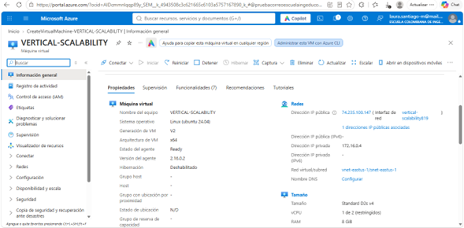


2. Para conectarse a la VM use el siguiente comando, donde las `x` las debe remplazar por la IP de su propia VM (Revise la sección "Connect" de la virtual machine creada para tener una guía más detallada).

   `ssh scalability_lab@xxx.xxx.xxx.xxx`

Conexión SSH. Acceso a la VM con ssh scalability_lab@<IP_PUBLICA>, autenticando con la llave pública configurada al crear la VM. Se ve el banner de Ubuntu con el uso de CPU, memoria y disco, y la IP privada 172.16.0.4. El prompt scalability_lab@VERTICAL-SCALABILITY confirma que estamos dentro de la máquina.

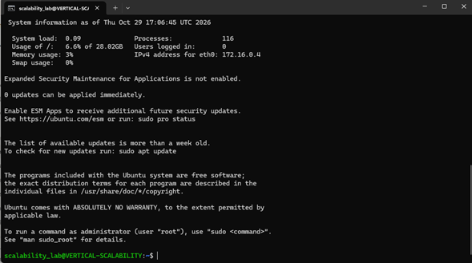


3. Instale node, para ello siga la sección *Installing Node.js and npm using NVM* que encontrará en este [enlace](https://linuxize.com/post/how-to-install-node-js-on-ubuntu-18.04/).
4. Para instalar la aplicación adjunta al Laboratorio, suba la carpeta `FibonacciApp` a un repositorio al cual tenga acceso y ejecute estos comandos dentro de la VM:

   `git clone <your_repo>`

   `cd <your_repo>/FibonacciApp`

   `npm install`

5. Para ejecutar la aplicación puede usar el comando `npm FibinacciApp.js`, sin embargo una vez pierda la conexión ssh la aplicación dejará de funcionar. Para evitar ese compartamiento usaremos *forever*. Ejecute los siguientes comando dentro de la VM.

   ` node FibonacciApp.js`

Paso 3: se instaló Node con NVM: node -v → v18.20.8, npm -v → 10.8.2.
Paso 4: se clonó el repositorio propio (git clone .../LauLau1214/ARSW_LOAD-BALANCING_AZURE.git) que contiene la carpeta FibonacciApp, y se instalaron las dependencias con npm install (51 paquetes; las advertencias de vulnerabilidades y del lockfile antiguo son del proyecto del lab y no afectan la prueba).
Paso 5: node FibonacciApp.js inicia el servidor: Fibonacci App listening on port 3000! y atiende la petición de prueba (calculate 6 number).

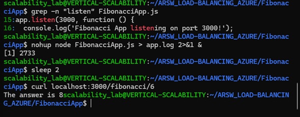

Ejecución persistente con nohup. Con node FibonacciApp.js el proceso depende de la sesión SSH y muere al cerrarla (SIGHUP). Para evitarlo se lanzó con nohup node FibonacciApp.js > app.log 2>&1 &: ignora SIGHUP, envía la salida a app.log y corre en segundo plano ([1] 2733 es el PID). Se verificó con curl localhost:3000/fibonacci/6, que devolvió The answer is 8. (El lab propone forever; nohup cumple el mismo objetivo sin instalar nada.)

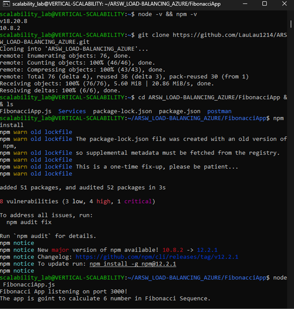

6. Antes de verificar si el endpoint funciona, en Azure vaya a la sección de *Networking* y cree una *Inbound port rule* tal como se muestra en la imágen. Para verificar que la aplicación funciona, use un browser y user el endpoint `http://xxx.xxx.xxx.xxx:3000/fibonacci/6`. La respuesta debe ser `The answer is 8`.


Regla de entrada del puerto 3000. Reglas de entrada del grupo de seguridad de red VERTICAL-SCALABILITYNSG: default-allow-ssh (prioridad 1000, TCP 22) y open-port-3000 (prioridad 1010, puerto 3000, origen cualquiera, acción Allow). Las reglas por defecto (65000-65500) permiten solo tráfico interno de la VNet y del balanceador, y DenyAllInBound bloquea todo lo demás.

Por qué es necesaria: sin open-port-3000, la petición HTTP desde Internet cae en DenyAllInBound y nunca llega a la app, aunque esté corriendo.

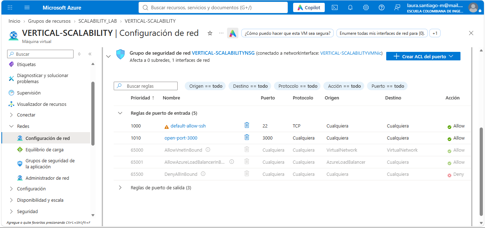


7. La función que calcula en enésimo número de la secuencia de Fibonacci está muy mal construido y consume bastante CPU para obtener la respuesta. Usando la consola del Browser documente los tiempos de respuesta para dicho endpoint usando los siguintes valores:
   * 1000000
   * 1010000
   * 1020000
   * 1030000
   * 1040000
   * 1050000
   * 1060000
   * 1070000
   * 1080000
   * 1090000

Verificación del endpoint y tiempos de respuesta. En el navegador, http://<IP>:3000/fibonacci/6 responde The answer is 8, lo que confirma que la regla de entrada del puerto 3000 está activa. En la consola se ejecutó un script que llama en secuencia a /fibonacci/N con N de 1.000.000 a 1.090.000 y mide el tiempo con performance.now(). A la derecha, la terminal SSH muestra cada petición recibida por la app.

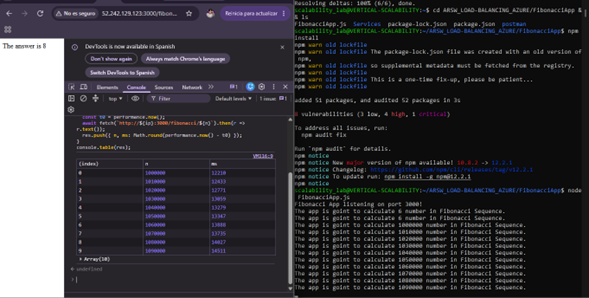

Interpretación: una sola petición tarda 12-14.5 s. La función no hace I/O: calcula con números gigantes y mantiene la CPU ocupada. El tiempo crece con N (+19% de tiempo para +9% de N).


8. Dírijase ahora a Azure y verifique el consumo de CPU para la VM. (Los resultados pueden tardar 5 minutos en aparecer).


Consumo de CPU tras las 10 peticiones. Gráfica de Percentage CPU (Max) en Azure Monitor. El pico de ~48.7% corresponde a las 10 peticiones secuenciales. El tramo plano de ~37% al inicio es el arranque de la VM, no la app.
Interpretación: Node ejecuta JavaScript en un solo hilo: la función satura un núcleo al 100%. Como D2s_v4 tiene 2 vCPU, eso equivale a ~50% del total.

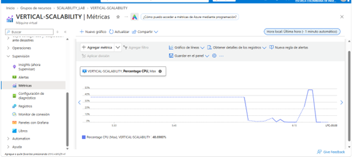


9. Ahora usaremos Postman para simular una carga concurrente a nuestro sistema. Siga estos pasos.
   * Instale newman con el comando `npm install newman -g`. Para conocer más de Newman consulte el siguiente [enlace](https://learning.getpostman.com/docs/postman/collection-runs/command-line-integration-with-newman/).
   * Diríjase hasta la ruta `FibonacciApp/postman` en una maquina diferente a la VM.
   * Para el archivo `[ARSW_LOAD-BALANCING_AZURE].postman_environment.json` cambie el valor del parámetro `VM1` para que coincida con la IP de su VM.
   * Ejecute el siguiente comando.

    ```
    newman run ARSW_LOAD-BALANCING_AZURE.postman_collection.json -e [ARSW_LOAD-BALANCING_AZURE].postman_environment.json -n 10 &
    newman run ARSW_LOAD-BALANCING_AZURE.postman_collection.json -e [ARSW_LOAD-BALANCING_AZURE].postman_environment.json -n 10
    ```
Resumen de Newman con 2 ejecuciones en paralelo.

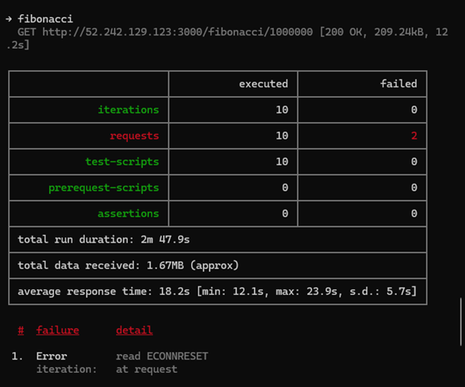
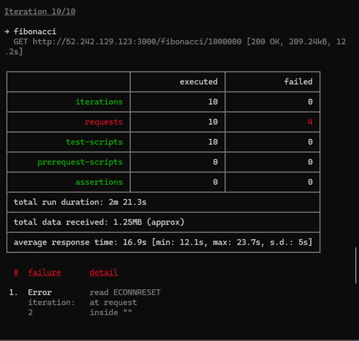

Interpretación: con dos clientes simultáneos el promedio sube de ~12 s (una sola) a ~17-18 s porque Node atiende de a una petición y las demás esperan en cola. Los fallos son read ECONNRESET: la conexión se cortó mientras esperaba, porque el servidor saturado no respondió a tiempo. Fallaron 6 de 20 peticiones (30%), por lo que no se cumple “todas las peticiones deben ser respondidas”.

CPU durante la carga concurrente (D2s_v4). La CPU sube a ~49.6% y se mantiene al ejecutar Newman. La línea punteada final corresponde a datos aún no publicados por Azure.

Interpretación: casi igual que con una sola petición (~49%): el segundo cliente no usa otro núcleo, solo alarga la cola del único hilo de Node. El CPU total no pasa del 50%, pero ese único núcleo está al 100% y por eso fallan peticiones.

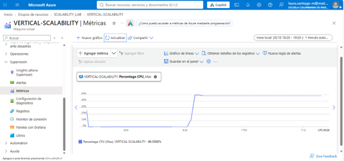


10. La cantidad de CPU consumida es bastante grande y un conjunto considerable de peticiones concurrentes pueden hacer fallar nuestro servicio. Para solucionarlo usaremos una estrategia de Escalamiento Vertical. En Azure diríjase a la sección *size* y a continuación seleccione el tamaño `B2ms`.


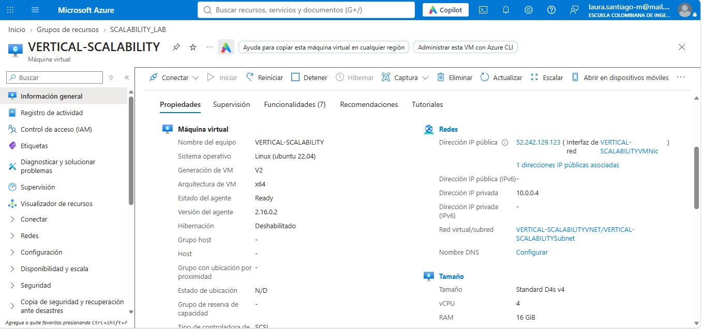

11. Una vez el cambio se vea reflejado, repita el paso 7, 8 y 9.

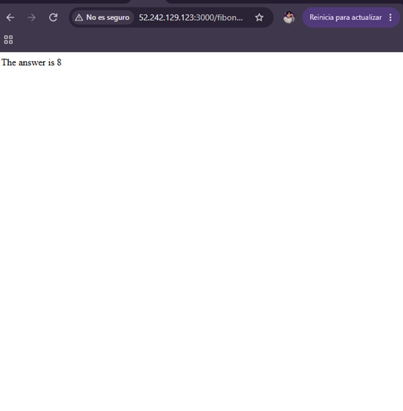

App funcionando tras el cambio de tamaño. Tras escalar la VM a D4s_v4 (4 vCPU, 16 GiB) la máquina se reinició y el proceso node se perdió. Se volvió a lanzar node FibonacciApp.js y el endpoint /fibonacci/6 responde The answer is 8. Esto evidencia el efecto del resize: hay downtime y la app no se levanta sola.

Tiempos de respuesta en D4s_v4. Misma prueba del paso 7. A la derecha, la terminal tras reconectar por SSH: la sesión nueva (Last login) confirma el reinicio.

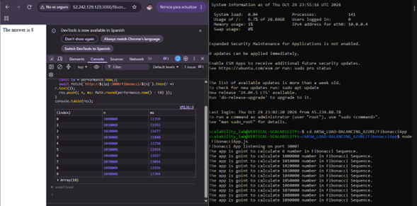

Interpretación: mejora de ~7%. Una sola petición usa un núcleo; duplicar los vCPU no la acelera, solo mejora un poco la velocidad del núcleo.


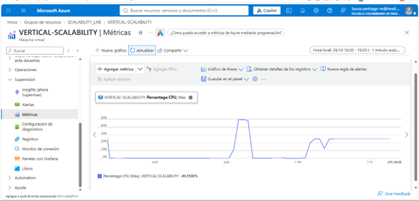

CPU antes y después del resize. Pico de ~49% a las 6:47 (D2s_v4, 2 vCPU) y meseta de ~24% desde las 7:02 (D4s_v4, 4 vCPU) con la misma carga de 2 ejecuciones paralelas.
Interpretación: el porcentaje cae a la mitad porque hay el doble de núcleos, pero un núcleo sigue al 100% (Node es mono-hilo). Mejoró la métrica, no el servicio.

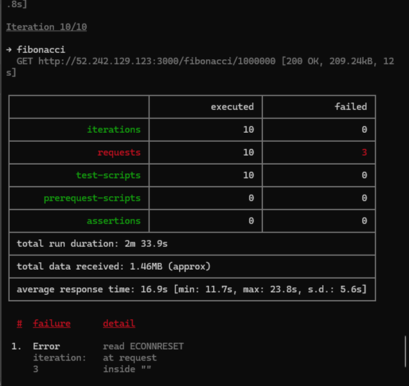

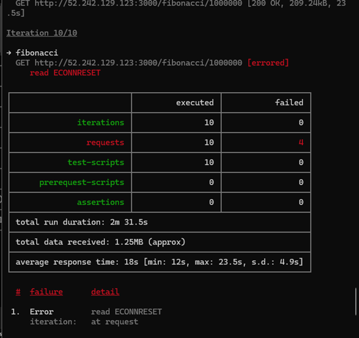

Comparación con D2s_v4: promedios 18.2/16.9 s → 16.9/18.0 s; fallos 2 y 4 → 3 y 4 (6 → 7 de 20). No hay mejora relevante: el cuello de botella es el hilo único de Node, no la cantidad de CPU.

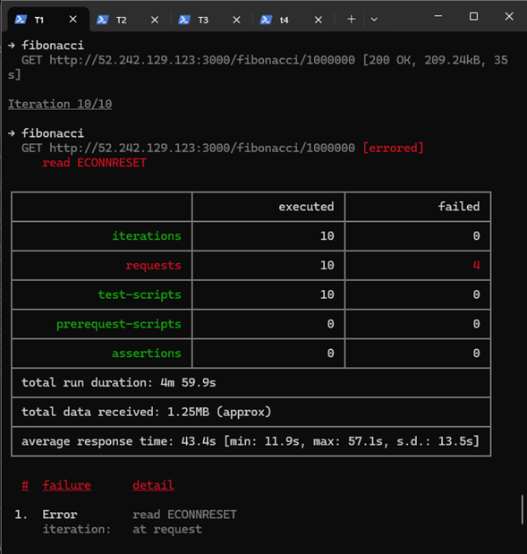

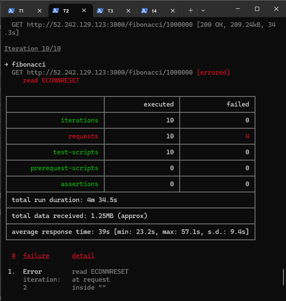

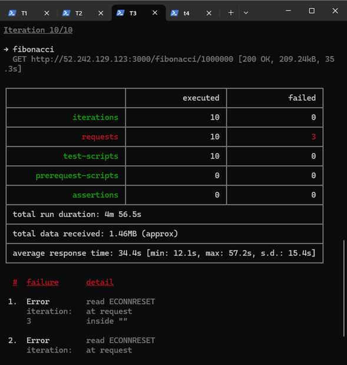

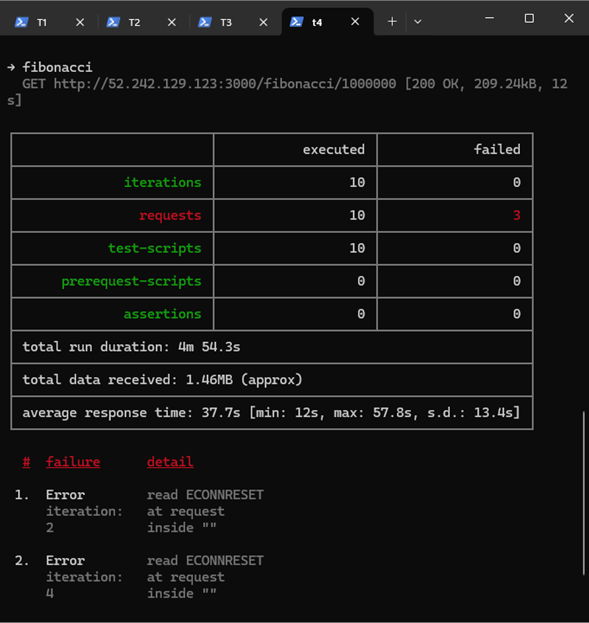

Interpretación: al duplicar los clientes el tiempo promedio se multiplica ×2.2 y el máximo llega a ~57 s. El sistema no mejora, empeora: la cola de un solo hilo crece linealmente.

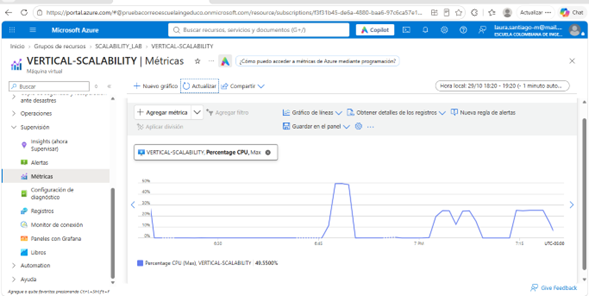

CPU con 4 ejecuciones paralelas. El último bloque (7:13-7:25) se mantiene en ~24% durante ~5 min, igual que con 2 paralelas. Cae al terminar la prueba.

Interpretación: aunque hay 4 clientes, la CPU total no sube: Node solo usa 1 de los 4 núcleos. Lo que crece no es el consumo sino la espera. Por eso escalar verticalmente no cumple el escenario de calidad.

12. Evalue el escenario de calidad asociado al requerimiento no funcional de escalabilidad y concluya si usando este modelo de escalabilidad logramos cumplirlo.

**Evaluación del escenario de calidad (escalabilidad vertical):**

| Condición del escenario | D2s_v4 (2 vCPU) | D4s_v4 (4 vCPU) | ¿Se cumple? |
|---|---|---|---|
| CPU ≤ 70 % | ~49 % | ~24 % | ✅ Sí |
| Todas las peticiones respondidas (2 en paralelo) | 14/20 (70 %) | 13/20 (65 %) | ❌ No |
| Todas las peticiones respondidas (4 en paralelo) | – | 26/40 (65 %) | ❌ No |

**Conclusión:** con escalabilidad vertical **no se cumple** el escenario. La condición de CPU se cumple, e incluso "mejora" al escalar (de ~49 % a ~24 %), pero solo porque el mismo trabajo se reparte entre más núcleos en el porcentaje total. La condición que importa, que todas las peticiones sean respondidas, falla tanto en la VM pequeña como en la grande (~30-35 % de fallos `ECONNRESET`). El cuello de botella es que Node.js atiende el cálculo en **un solo hilo**: agregar vCPU a la misma máquina no agrega capacidad de atender peticiones en paralelo, solo deja núcleos sin usar. Además el resize implicó **downtime** y volver a levantar la app a mano. Para cumplir el escenario hace falta repartir las peticiones concurrentes entre varios procesos o máquinas, que es lo que se hace en la Parte 2.

13. Vuelva a dejar la VM en el tamaño inicial para evitar cobros adicionales.


Videos

[Video 1](https://drive.google.com/file/d/1TN1fA4-5X49dAXoR4kdJkchuQ2SZ5fBZ/view?usp=drive_link)

[Video 2](https://drive.google.com/file/d/1TGOLm27R7wvmSNc3C-X0rt2x3Vr9CUvK/view?usp=drive_link)

**Preguntas**

1. ¿Cuántos y cuáles recursos crea Azure junto con la VM?

Azure creó 6 recursos dentro del grupo SCALABILITY_LAB:

Máquina virtual VERTICAL-SCALABILITY
Disco del sistema operativo (..._OsDisk_1_...)
Interfaz de red (VERTICAL-SCALABILITYVMNic)
Dirección IP pública (VERTICAL-SCALABILITYPublicIP)
Grupo de seguridad de red (VERTICAL-SCALABILITYNSG)
Red virtual (VERTICAL-SCALABILITYVNET)

2. ¿Brevemente describa para qué sirve cada recurso?

Máquina virtual: Servidor (CPU y RAM) donde corre Ubuntu y la aplicación.
Disco del SO: Almacenamiento persistente con el sistema operativo y los archivos; se conserva aunque la VM se apague.
Interfaz de red (NIC): Tarjeta de red virtual que conecta la VM con la red y le asigna sus direcciones IP.
IP pública: Dirección accesible desde Internet, usada para SSH y para consumir el servicio por el puerto 3000.
Grupo de seguridad de red (NSG): Firewall con reglas de entrada y salida por puerto, protocolo y origen.
Red virtual (VNet): Red privada y aislada donde viven la VM y su NIC (IP privada de la subred).

3. ¿Al cerrar la conexión ssh con la VM, por qué se cae la aplicación que ejecutamos con el comando `npm FibonacciApp.js`? ¿Por qué debemos crear un *Inbound port rule* antes de acceder al servicio?

- Con node FibonacciApp.js el proceso corre en primer plano como proceso hijo de la sesión SSH. Al cerrar la conexión, el sistema envía la señal SIGHUP a la sesión y esta termina a sus procesos hijos, incluida la aplicación. Para evitarlo se desacopló el proceso de la sesión con nohup node FibonacciApp.js > app.log 2>&1 & (alternativas: forever, pm2 o un servicio systemd).
- El NSG bloquea por defecto todo el tráfico entrante de Internet, salvo lo que una regla permita (inicialmente solo SSH, puerto 22). La regla DenyAllInBound descarta cualquier otra petición. Sin la regla open-port-3000, las peticiones HTTP nunca llegan a la aplicación aunque esté en ejecución (Imagen de reglas NSG).

4. Adjunte tabla de tiempos e interprete por qué la función tarda tando tiempo.

n	     D2s_v4 (ms)	D4s_v4 (ms)
1000000	    12210	       11359
1010000	    12433	       11551
1020000	    12771	       11677
1030000	    13059	       11840
1040000	    13279	       12250
1050000	    13347	       12454
1060000	    13888	       12657
1070000	    13735	       13054
1080000	    14027	       12926
1090000	    14511	       13394

Interpretación: una sola petición tarda entre 12 y 14.5 segundos. La función es muy costosa: calcula un número de Fibonacci con cifras gigantes (la respuesta pesa ~209 kB) usando un algoritmo ineficiente y no tiene esperas de entrada/salida, por lo que mantiene la CPU ocupada durante todo el cálculo. Además, el tiempo crece más rápido que n: de 1.000.000 a 1.090.000 (+9%) el tiempo sube ~19% en D2s_v4, porque cada paso opera con números más grandes.

5. Adjunte imágen del consumo de CPU de la VM e interprete por qué la función consume esa cantidad de CPU.


Interpretación: el consumo llega a ~49%, no al 100%. Node.js ejecuta JavaScript en un solo hilo, así que la función satura un núcleo al 100%; como D2s_v4 tiene 2 vCPU, eso equivale a ~50% de la CPU total de la VM. El otro núcleo queda sin usar. (El tramo plano de ~37% al inicio de la primera gráfica corresponde al arranque de la VM, no a la aplicación.)

6. Adjunte la imagen del resumen de la ejecución de Postman. Interprete:
   * Tiempos de ejecución de cada petición.
   * Si hubo fallos documentelos y explique.


- Tiempos de ejecución: una petición sola tarda ~12 s; con dos clientes simultáneos el promedio sube a ~17-18 s y el máximo a ~24 s, porque Node atiende de a una petición y las otras esperan en cola.
- Fallos: hubo 6 fallos en 20 peticiones (30%), todos read ECONNRESET: la conexión fue cerrada mientras esperaba respuesta, porque el servidor saturado no alcanzó a atenderla a tiempo. Las “iterations” aparecen en 0 fallos porque no hay assertions; solo se contabiliza el error de conexión.


7. ¿Cuál es la diferencia entre los tamaños `B2ms` y `B1ls` (no solo busque especificaciones de infraestructura)?

Ambas pertenecen a la serie B (burstable): tienen un rendimiento base reducido y acumulan créditos de CPU mientras están por debajo de él, que consumen para ráfagas de hasta el 100%. B1ls es la más pequeña (1 vCPU, ~0.5 GiB de RAM, rendimiento base muy bajo); B2ms tiene 2 vCPU, 8 GiB de RAM, un rendimiento base mayor y más créditos. La diferencia importante es de comportamiento: con carga sostenida (como nuestro cálculo de Fibonacci) los créditos se agotan y la VM queda limitada a su rendimiento base, por lo que estas VM sirven para cargas esporádicas y no para CPU constante. B2ms solo aguanta más tiempo y no elimina el problema.

8. ¿Aumentar el tamaño de la VM es una buena solución en este escenario?, ¿Qué pasa con la FibonacciApp cuando cambiamos el tamaño de la VM?

No es una buena solución para este escenario. Probamos subir de D2s_v4 a D4s_v4 y los tiempos de respuesta y los fallos no mejoraron de forma relevante, porque la aplicación usa un único hilo y no aprovecha los núcleos adicionales.
Respecto a la aplicación: al cambiar el tamaño la VM se reinicia, el proceso node se pierde y hay que volver a lanzarlo manualmente (Imagen tras el resize). El código y los archivos permanecen en el disco.

9. ¿Qué pasa con la infraestructura cuando cambia el tamaño de la VM? ¿Qué efectos negativos implica?

Azure detiene la VM, la reasigna a hardware que soporte el nuevo tamaño y la vuelve a iniciar, reconectando el mismo disco y la misma NIC. Efectos negativos:

- Downtime: el servicio no está disponible durante el cambio.
- Se pierden los procesos en memoria (la app no se levanta sola).
- Posible cambio de IP si la IP pública es dinámica (la nuestra era estándar/estática y se mantuvo).
- Mayor costo por hora.
- Es un cambio manual y limitado por el tamaño máximo del hardware; no es elástico ni automático.

10. ¿Hubo mejora en el consumo de CPU o en los tiempos de respuesta? Si/No ¿Por qué?

- Consumo de CPU: sí, en porcentaje: pasó de ~49% (D2s_v4) a ~24% (D4s_v4) con la misma carga, porque ahora hay 4 núcleos en lugar de 2 y la carga sigue ocupando uno.
- Tiempos de respuesta: prácticamente no. Una sola petición mejoró ~7% (12.2 s → 11.4 s) y con 2 ejecuciones paralelas de Postman los promedios siguieron en ~17 s (18.2/16.9 s → 16.9/18.0 s) con los mismos fallos (6 → 7 de 20). Mejoró la métrica de CPU, pero no la calidad del servicio: el cuello de botella es el hilo único de Node.

11. Aumente la cantidad de ejecuciones paralelas del comando de postman a `4`. ¿El comportamiento del sistema es porcentualmente mejor?

No, es peor. Resultados en D4s_v4 (Imágenes T1 a T4):

	T1	        T2	        T3	      T4
Duración	4m 59.9s	4m 34.5s	4m 56.5s	4m 54.3s
Promedio	43.4 s	39.0 s	34.4 s	37.7 s
Mín / Máx	11.9 / 57.1 s	23.2 / 57.1 s	12.1 / 57.2 s	12.0 / 57.8 s
Fallos	4	4	3	3
1 petición	2 paralelas	4 paralelas
Tiempo promedio	~12 s	~17.5 s	~38.6 s
Tiempo máximo	~14 s	~23.8 s	~57 s
Fallos	0	7/20 (35%)	14/40 (35%)

Al duplicar los clientes (2 → 4), el tiempo promedio se multiplica por ~2.2 y el máximo llega a ~57 s; el porcentaje de fallos se mantiene en ~35%. La CPU total se quedó en ~24% (Imagen de CPU con 4 paralelas): no aumenta el consumo, aumenta la espera, porque todas las peticiones se encolan en un único hilo. El sistema no mejora al recibir más carga, se degrada.

### Parte 2 - Escalabilidad horizontal

#### Crear el Balanceador de Carga

Antes de continuar puede eliminar el grupo de recursos anterior para evitar gastos adicionales y realizar la actividad en un grupo de recursos totalmente limpio.

1. El Balanceador de Carga es un recurso fundamental para habilitar la escalabilidad horizontal de nuestro sistema, por eso en este paso cree un balanceador de carga dentro de Azure tal cual como se muestra en la imágen adjunta.


2. A continuación cree un *Backend Pool*, guiese con la siguiente imágen.


3. A continuación cree un *Health Probe*, guiese con la siguiente imágen.


4. A continuación cree un *Load Balancing Rule*, guiese con la siguiente imágen.


5. Cree una *Virtual Network* dentro del grupo de recursos, guiese con la siguiente imágen.


#### Crear las maquinas virtuales (Nodos)

Ahora vamos a crear 3 VMs (VM1, VM2 y VM3) con direcciones IP públicas standar en 3 diferentes zonas de disponibilidad. Después las agregaremos al balanceador de carga.

1. En la configuración básica de la VM guíese por la siguiente imágen. Es importante que se fije en la "Avaiability Zone", donde la VM1 será 1, la VM2 será 2 y la VM3 será 3.


2. En la configuración de networking, verifique que se ha seleccionado la *Virtual Network*  y la *Subnet* creadas anteriormente. Adicionalmente asigne una IP pública y no olvide habilitar la redundancia de zona.


3. Para el Network Security Group seleccione "avanzado" y realice la siguiente configuración. No olvide crear un *Inbound Rule*, en el cual habilite el tráfico por el puerto 3000. Cuando cree la VM2 y la VM3, no necesita volver a crear el *Network Security Group*, sino que puede seleccionar el anteriormente creado.


4. Ahora asignaremos esta VM a nuestro balanceador de carga, para ello siga la configuración de la siguiente imágen.


5. Finalmente debemos instalar la aplicación de Fibonacci en la VM. para ello puede ejecutar el conjunto de los siguientes comandos, cambiando el nombre de la VM por el correcto

```
git clone https://github.com/daprieto1/ARSW_LOAD-BALANCING_AZURE.git

curl -o- https://raw.githubusercontent.com/creationix/nvm/v0.34.0/install.sh | bash
source /home/vm1/.bashrc
nvm install node

cd ARSW_LOAD-BALANCING_AZURE/FibonacciApp
npm install

npm install forever -g
forever start FibonacciApp.js
```

Realice este proceso para las 3 VMs, por ahora lo haremos a mano una por una, sin embargo es importante que usted sepa que existen herramientas para aumatizar este proceso, entre ellas encontramos Azure Resource Manager, OsDisk Images, Terraform con Vagrant y Paker, Puppet, Ansible entre otras.

#### Probar el resultado final de nuestra infraestructura

1. Porsupuesto el endpoint de acceso a nuestro sistema será la IP pública del balanceador de carga, primero verifiquemos que los servicios básicos están funcionando, consuma los siguientes recursos:

```
http://52.155.223.248/
http://52.155.223.248/fibonacci/1
```

2. Realice las pruebas de carga con `newman` que se realizaron en la parte 1 y haga un informe comparativo donde contraste: tiempos de respuesta, cantidad de peticiones respondidas con éxito, costos de las 2 infraestrucruras, es decir, la que desarrollamos con balanceo de carga horizontal y la que se hizo con una maquina virtual escalada.

3. Agregue una 4 maquina virtual y realice las pruebas de newman, pero esta vez no lance 2 peticiones en paralelo, sino que incrementelo a 4. Haga un informe donde presente el comportamiento de la CPU de las 4 VM y explique porque la tasa de éxito de las peticiones aumento con este estilo de escalabilidad.

```
newman run ARSW_LOAD-BALANCING_AZURE.postman_collection.json -e [ARSW_LOAD-BALANCING_AZURE].postman_environment.json -n 10 &
newman run ARSW_LOAD-BALANCING_AZURE.postman_collection.json -e [ARSW_LOAD-BALANCING_AZURE].postman_environment.json -n 10 &
newman run ARSW_LOAD-BALANCING_AZURE.postman_collection.json -e [ARSW_LOAD-BALANCING_AZURE].postman_environment.json -n 10 &
newman run ARSW_LOAD-BALANCING_AZURE.postman_collection.json -e [ARSW_LOAD-BALANCING_AZURE].postman_environment.json -n 10
```

**Preguntas**

* ¿Cuáles son los tipos de balanceadores de carga en Azure y en qué se diferencian?, ¿Qué es SKU, qué tipos hay y en qué se diferencian?, ¿Por qué el balanceador de carga necesita una IP pública?
* ¿Cuál es el propósito del *Backend Pool*?
* ¿Cuál es el propósito del *Health Probe*?
* ¿Cuál es el propósito de la *Load Balancing Rule*? ¿Qué tipos de sesión persistente existen, por qué esto es importante y cómo puede afectar la escalabilidad del sistema?.
* ¿Qué es una *Virtual Network*? ¿Qué es una *Subnet*? ¿Para qué sirven los *address space* y *address range*?
* ¿Qué son las *Availability Zone* y por qué seleccionamos 3 diferentes zonas?. ¿Qué significa que una IP sea *zone-redundant*?
* ¿Cuál es el propósito del *Network Security Group*?
* Informe de newman 1 (Punto 2)
* Presente el Diagrama de Despliegue de la solución.

---

## Desarrollo – Parte 2: Escalabilidad horizontal

> El paso a paso con todas las capturas está en [`EVIDENCIAS.md`](EVIDENCIAS.md).

### Ajustes

La suscripción de estudiante tiene varios límites, así que al final quedó un poco distinto:

| Guía | Lo que hicimos | Por qué |
|---|---|---|
| Región North Europe | **Central US** | La suscripción tiene una política (*Allowed resource deployment regions*) que solo permite `southcentralus`, `canadacentral`, `northcentralus`, `centralus` y `mexicocentral`. East US 2 falló por *policy violation*. |
| VMs tamaño B1ls | **Standard_D2s_v3** (VM1, VM3) y **Standard_D2s_v4** (VM2), 2 vCPU / 8 GB | Toda la serie B (B1ls, B1s, B2ats_v2) sale como *"Tamaño no disponible"* para la suscripción en Central US. La familia DSv3 tiene tope de 4 vCPU, por eso VM2 quedó en D2s_v4 (mismas specs). |
| 4 VMs | **3 VMs** | Tope de **6 vCPU regionales**: 3 VMs × 2 vCPU = 6. No hay tamaños de 1 vCPU disponibles para la suscripción. |
| IP pública en cada VM | IP pública en **VM1, VM2 y el LB**; VM3 solo IP privada | Tope de **3 IPs públicas por región** (`PublicIPCountLimitReached`). A VM3 se le quitó la IP después de instalar la app; el LB le llega por la IP privada, así que no afecta. |
| Instalación manual por SSH con nvm + `forever` | **cloud-init** ([`cloud-init-fibonacci.yaml`](cloud-init-fibonacci.yaml)) + servicio **systemd** | Cada VM se instala sola al arrancar. systemd, además de mantener la app viva sin sesión SSH, la vuelve a levantar si la VM se reinicia. |
| `&` para paralelizar newman | Varias ventanas de PowerShell (`Start-Process`) | PowerShell no acepta `&` como operador de segundo plano. |

### Infraestructura desplegada

| Recurso | Nombre | Configuración |
|---|---|---|
| Grupo de recursos | `SCALABILITY_LAB` | Central US |
| Virtual Network | `SCALABILITY_LAB_VIRTUAL_NETWORK` | Address space `10.1.0.0/16` |
| Subnet | `SCALABILITY_LAB_SUBNET` | Address range `10.1.0.0/24` |
| Load Balancer | `SCALABILITY_LAB_LOAD_BALANCER` | SKU Estándar, Público, Regional |
| Front-end | `LoadBalancerFrontEnd` | IP pública estática **zone-redundant** `48.214.164.243` |
| Backend pool | `SCALABILITY_LAB_BACKEND_POOL` | VM1, VM2, VM3 (por NIC) |
| Health probe | `SCALABILITY_LAB_HEALTH_PROBE` | TCP 3000, cada 5 s |
| Regla de balanceo | `SCALABILITY_LAB_LOAD_BALANCING_RULE` | TCP 80 → 3000, sin persistencia de sesión |
| NSG | `SCALABILITY_LAB_NSG` | Entrada: 22 (SSH, prioridad 1000) y 3000 (app, prioridad 310) |
| VM1 | Zona 1 | D2s_v3 · IP privada 10.1.0.4 |
| VM2 | Zona 2 | D2s_v4 · IP privada 10.1.0.6 |
| VM3 | Zona 3 | D2s_v3 · IP privada 10.1.0.5 |

### Probar el resultado final

**Punto 1 – Servicios básicos a través del LB** ([evidencia 13](EVIDENCIAS.md#13-prueba-de-la-app-a-través-del-load-balancer)):
- `http://48.214.164.243/` → `Hello World`
- `http://48.214.164.243/fibonacci/6` → `The answer is 8`

Además se probó cada nodo directo por su IP pública en el puerto 3000 .

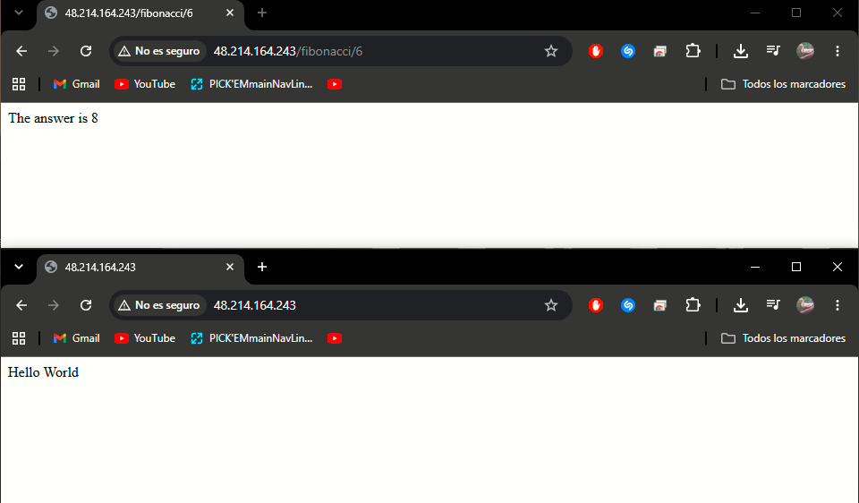

**Punto 2 – newman, 2 ejecuciones en paralelo** (`-n 10`, `nth = 1000000`):

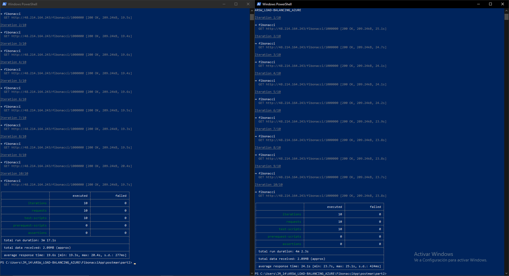

| Ejecución | Peticiones | Fallidas | Promedio | Mín – Máx | Desv. est. |
|---|---|---|---|---|---|
| 1 | 10 | 0 | 19,6 s | 19,3 – 20,4 s | 277 ms |
| 2 | 10 | 0 | 24,1 s | 23,7 – 25,1 s | 424 ms |
| **Total** | **20** | **0** | | | **100 % de éxito** |

**Punto 3 – newman, 4 ejecuciones en paralelo con 3 nodos:**

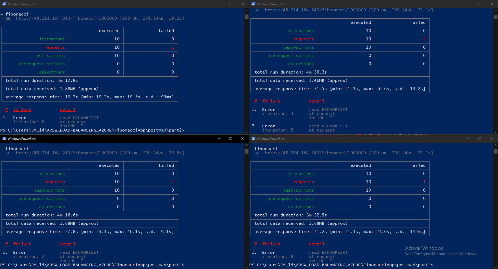

| Ejecución | Peticiones | Fallidas | Promedio | Mín – Máx | Desv. est. |
|---|---|---|---|---|---|
| 1 | 10 | 1 | 19,2 s | 19,2 – 19,5 s | 99 ms |
| 2 | 10 | 3 | 31,5 s | 21,1 – 56,6 s | 13,2 s |
| 3 | 10 | 1 | 27,8 s | 23,1 – 46,1 s | 9,1 s |
| 4 | 10 | 1 | 21,2 s | 21,1 – 21,6 s | 142 ms |
| **Total** | **40** | **6** (`ECONNRESET`) | | | **85 % de éxito** |

**Comportamiento de la CPU** (Percentage CPU, última hora):

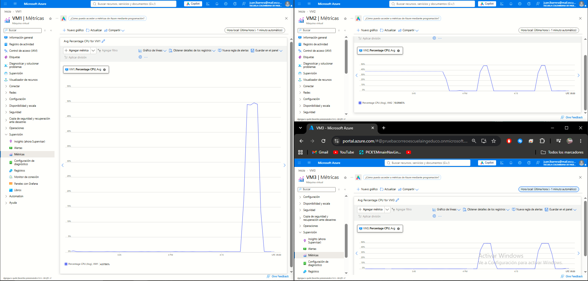

| VM | Prueba de 2 en paralelo | Prueba de 4 en paralelo |
|---|---|---|
| VM1 | ~0 % (no recibió carga) | ~50 % |
| VM2 | ~50 % | ~50 % |
| VM3 | ~50 % | ~50 % |

**Análisis del punto 3:**
- La 4.ª VM no se pudo crear por el tope de 6 vCPU, así que las 4 ejecuciones se repartieron entre 3 nodos y **a un nodo le tocaron dos flujos a la vez**.
- Esos dos flujos son los que muestran tiempos inestables (picos de 46 y 56 s, desviación de 9-13 s): FibonacciApp corre en **Node.js, de un solo hilo**, y mientras calcula una petición (~20 s) la otra espera en fila.
- Con el event loop bloqueado aparecen **6 `read ECONNRESET`** (el servidor cierra la conexión). Nuestra hipótesis es que los timers de keep-alive de Node se disparan tarde por el bloqueo y el servidor cierra sockets justo cuando newman manda la siguiente petición; al reconectar, el LB vuelve a hacer el hash y por eso también aparece algún fallo en los flujos que iban estables.
- **Ninguna VM pasa de ~50 % de CPU**, ni la que atendió dos flujos: con 2 vCPU, Node solo puede usar un núcleo. La saturación no se ve como más CPU, sino como más espera.
- **¿Por qué aumenta la tasa de éxito con este estilo de escalabilidad?** Porque cada nodo nuevo agrega un núcleo más que realmente atiende peticiones en paralelo. Con 2 flujos y 3 nodos, cada flujo tuvo su propio nodo: **100 % de éxito** y tiempos estables. Con 4 flujos y 3 nodos bajó a **85 %**. Con la 4.ª VM que pide la guía, cada flujo tendría su nodo y el resultado debería volver a parecerse al de la prueba de 2 (estable y sin fallos). Agrandar una sola VM no logra esto, porque Node no aprovecha los núcleos extra.

### Preguntas

**1. ¿Cuáles son los tipos de balanceadores de carga en Azure y en qué se diferencian? ¿Qué es SKU, qué tipos hay y en qué se diferencian? ¿Por qué el balanceador de carga necesita una IP pública?**

Azure tiene cuatro servicios de balanceo:

| Servicio | Capa | Alcance | Para qué sirve |
|---|---|---|---|
| **Azure Load Balancer** | L4 (TCP/UDP) | Regional (o global con el nivel *Global*) | Reparte conexiones TCP/UDP entre VMs. Es el que usamos. |
| **Application Gateway** | L7 (HTTP/HTTPS) | Regional | Enruta por URL o host, termina TLS, trae WAF y afinidad por cookie. |
| **Azure Front Door** | L7 (HTTP/HTTPS) | Global | Puerta de entrada global con caché, failover rápido entre regiones y WAF. |
| **Traffic Manager** | DNS | Global | No toca el tráfico: responde el DNS con el endpoint que convenga (por prioridad, rendimiento o geografía). |

El **SKU** es la "versión o plan" de un recurso, y define sus capacidades, límites, SLA y precio. Para el Load Balancer hay:
- **Básico:** sin zonas de disponibilidad, sin SLA y abierto por defecto. **Microsoft lo retiró el 30 de septiembre de 2025**, por eso ya no aparece como opción.
- **Estándar:** soporta zonas (frontends zone-redundant), tiene SLA, más instancias por pool, métricas en Azure Monitor y es **seguro por defecto** (no deja pasar nada que no permita un NSG). Es el que usamos.
- **Gateway:** para encadenar appliances virtuales de red de terceros (firewalls, inspección de paquetes) en medio del tráfico. No reparte carga entre VMs de aplicación.

Además el Estándar tiene dos **niveles**: *Regional* (una región, el nuestro) y *Global* (reparte entre balanceadores de varias regiones).

**¿Por qué IP pública?** Porque es un balanceador **público**: es la única puerta de entrada al sistema desde internet. Los clientes (newman en nuestro PC) solo conocen la IP del LB, y el LB habla con las VMs por sus IPs privadas. Si fuera un LB **interno**, tendría solo IP privada y únicamente sería accesible desde dentro de la VNet.

**2. ¿Cuál es el propósito del *Backend Pool*?**

Es el **grupo de instancias que van a atender el tráfico**: la lista de NICs (o IPs) a las que el LB les puede mandar peticiones. En nuestro caso tiene las NICs de VM1, VM2 y VM3. Es lo que hace fácil escalar horizontalmente: para agregar capacidad solo se mete otra VM al pool, sin cambiar la IP que usan los clientes ni ninguna otra configuración. (Evidencias 6 y 16.)

**3. ¿Cuál es el propósito del *Health Probe*?**

Revisar periódicamente si cada instancia del pool está viva, para que el LB **solo le mande tráfico a las sanas**. El nuestro intenta abrir una conexión TCP al puerto 3000 de cada VM cada 5 s; si una deja de responder, el LB la saca de la rotación hasta que vuelva.

Detalle interesante que vimos: un probe **TCP** solo comprueba que el puerto acepte conexiones, y eso lo hace el kernel aunque Node esté bloqueado calculando. O sea que una VM saturada sigue apareciendo como sana. Un probe **HTTP** a un endpoint de la app (por ejemplo `/`) sí detectaría que la VM no está respondiendo a tiempo.

**4. ¿Cuál es el propósito de la *Load Balancing Rule*? ¿Qué tipos de sesión persistente existen, por qué esto es importante y cómo puede afectar la escalabilidad del sistema?**

La regla **conecta las piezas**: dice qué tráfico que llega al front-end (IP, protocolo y puerto) se reparte a qué backend pool, a qué puerto del backend y con qué health probe. La nuestra toma TCP **80** del front-end y lo manda al puerto **3000** de las VMs sanas del pool.

Tipos de persistencia (*distribution mode*):

| Modo | Hash | Comportamiento |
|---|---|---|
| **Ninguna** (default, la nuestra) | 5 tuplas: IP origen, puerto origen, IP destino, puerto destino, protocolo | Cada conexión nueva puede caer en cualquier instancia. |
| **IP de cliente** | 2 tuplas: IP origen, IP destino | Todas las peticiones de una misma IP de cliente van a la misma instancia. |
| **IP de cliente y protocolo** | 3 tuplas: IP origen, IP destino, protocolo | Igual que la anterior, pero separando por protocolo. |

**Por qué importa:** si la aplicación guarda estado en memoria (una sesión de usuario, un carrito), el cliente necesita volver siempre al mismo servidor; si no, "pierde" su sesión.

**Cómo afecta la escalabilidad:** la persistencia **desbalancea la carga**. Si muchos usuarios salen por la misma IP (una oficina o una universidad detrás de NAT), todos caen en la misma VM mientras las demás están libres, y agregar VMs no ayuda a esos usuarios. En nuestra prueba, con persistencia por IP de cliente, **todas** las ejecuciones de newman (que salen de la misma IP) habrían caído en una sola VM y el balanceo no habría servido de nada. Por eso lo ideal es que la app sea **stateless** (el estado en una BD o caché compartida) y dejar la persistencia en *Ninguna*. Aun sin persistencia vimos un efecto parecido en pequeño: cada newman reutiliza su conexión TCP, así que todas sus peticiones caen en la misma VM.

**5. ¿Qué es una *Virtual Network*? ¿Qué es una *Subnet*? ¿Para qué sirven los *address space* y *address range*?**

- **Virtual Network (VNet):** la red privada y aislada de nuestros recursos en Azure, el equivalente a la red de un datacenter propio. Ahí las VMs se comunican entre sí y con el LB por IPs privadas.
- **Subnet:** una división de la VNet. Sirve para separar recursos (por ejemplo web, BD y administración) y aplicarles reglas distintas (NSG, tablas de rutas).
- **Address space:** el rango total de IPs privadas de la VNet, en notación CIDR. El nuestro es `10.1.0.0/16`, o sea 65.536 direcciones (10.1.0.0 – 10.1.255.255).
- **Address range:** el pedazo de ese espacio que le toca a cada subred. El nuestro es `10.1.0.0/24` (256 direcciones, de las cuales Azure se reserva 5). De ahí salieron las IPs de las VMs: 10.1.0.4, 10.1.0.5 y 10.1.0.6.

(Evidencias 1 a 3.)

**6. ¿Qué son las *Availability Zones* y por qué seleccionamos 3 diferentes zonas? ¿Qué significa que una IP sea *zone-redundant*?**

Las **zonas de disponibilidad** son ubicaciones físicamente separadas dentro de una misma región: uno o más datacenters con su propia energía, refrigeración y red. Pusimos VM1, VM2 y VM3 en las zonas 1, 2 y 3 para que, si se cae un datacenter completo (un corte de energía, un incendio, una falla de red), **las otras dos VMs sigan atendiendo** y el sistema no se caiga. Esto suma alta disponibilidad a la escalabilidad.

Una IP **zone-redundant** no vive en una sola zona: Azure la replica en todas las zonas de la región, así que sigue funcionando aunque una zona falle. Por eso el front-end del LB es zone-redundant: si la IP de entrada estuviera solo en la zona 1, una caída de esa zona tumbaría todo el sistema aunque las VMs de las zonas 2 y 3 estuvieran bien. (Evidencia 5.)

**7. ¿Cuál es el propósito del *Network Security Group*?**

Es el **firewall de red** de las VMs. Tiene reglas de entrada y salida que permiten o niegan tráfico según origen, destino, puerto y protocolo, y se evalúan por **prioridad** (el número más bajo va primero). El nuestro (`SCALABILITY_LAB_NSG`) deja entrar **22** (SSH, para administración) y **3000** (la app). Sin la regla del 3000, ni el LB ni el health probe podrían llegar a la FibonacciApp. Con el LB Estándar esto es obligatorio, porque es seguro por defecto: si el NSG no lo permite, el tráfico no pasa. Usamos **un solo NSG compartido** por las 3 VMs para que las reglas sean idénticas en todos los nodos. (Evidencia 10.)

### Informe de newman 1 (Punto 2): vertical vs. horizontal

Misma carga en los tres escenarios: colección de newman con `nth = 1000000` y `-n 10` por ejecución.

| Criterio | Vertical – VM pequeña | Vertical – VM escalada | **Horizontal – LB + 3 VMs** |
|---|---|---|---|
| Infraestructura | 1× **D2s_v4** (2 vCPU / 8 GB) | 1× **D4s_v4** (4 vCPU / 16 GB) | 2× **D2s_v3** + 1× **D2s_v4** (2 vCPU / 8 GB c/u) + LB Estándar |
| **2 en paralelo – peticiones exitosas** | 14 / 20 (**70 %**) | 13 / 20 (**65 %**) | **20 / 20 (100 %)** |
| 2 en paralelo – tiempo promedio | 18,2 s y 16,9 s | 16,9 s y 18,0 s | 19,6 s y 24,1 s |
| 2 en paralelo – tiempo máximo | ~24 s | ~24 s | 25,1 s |
| **4 en paralelo – peticiones exitosas** | – | 26 / 40 (**65 %**) | **34 / 40 (85 %)** con 3 nodos |
| 4 en paralelo – tiempo promedio | – | ~38,6 s (34,4 – 43,4 s) | 19,2 / 21,2 / 27,8 / 31,5 s |
| 4 en paralelo – tiempo máximo | – | ~57 s | 56,6 s |
| CPU máxima | ~49 % | ~24 % | ~50 % por nodo |
| Costo de cómputo (Linux, Central US) | **0,108 USD/h** | **0,217 USD/h** | 2 × 0,110 + 1 × 0,108 = **0,328 USD/h** |
| Costos adicionales | 1 IP pública | 1 IP pública | 3 IPs públicas; el LB Estándar entró en las horas gratis de la cuenta de estudiante |
| Downtime al escalar | – | Sí (reinicio de la VM, la app se levantó a mano) | No (se agregan nodos al pool sin tocar los demás) |

**Análisis:**

- **Peticiones exitosas.** Es la diferencia más clara. En vertical se pierde ~30-35 % de las peticiones sin importar el tamaño de la VM: escalar de 2 a 4 vCPU **no mejoró nada** (70 % → 65 %). En horizontal, con 2 flujos concurrentes se respondió el **100 %**, e incluso con 4 flujos y solo 3 nodos se llegó al **85 %**, por encima del 65 % de la VM escalada con la misma carga.
- **Tiempos de respuesta.** En vertical los tiempos promedio con 2 clientes (~17-18 s) incluyen **espera en cola**: una petición sola tarda ~12 s y la segunda tiene que esperar a que el único hilo de Node termine. Con 4 clientes la cola crece y el promedio se va a ~38,6 s. En horizontal no hay cola mientras haya un nodo por flujo: cada ejecución mantuvo tiempos estables (desviación de 99 a 424 ms) y solo aparecieron picos de 46-56 s en los dos flujos que compartieron nodo en la prueba de 4.
- **Ojo con los tiempos absolutos.** En horizontal cada petición sola tardó ~19-24 s, contra ~12 s en la VM de la Parte 1, así que los tiempos absolutos no son directamente comparables. La causa más probable es la versión de Node: en la Parte 1 se instaló **Node 18 con NVM**, mientras que en la Parte 2 el cloud-init instaló el `nodejs` de los repositorios de Ubuntu 22.04 (**Node 12**), cuyo motor maneja más lento los números gigantes. A eso se suma que VM1 y VM3 son D2s_v3, de una generación de procesador más vieja. Por eso la comparación justa es en **tasa de éxito y en si hay o no cola**, no en segundos por petición.
- **CPU.** En vertical la CPU "baja" de 49 % a 24 % al escalar, pero es solo un efecto del porcentaje: Node sigue usando un núcleo al 100 % y los demás quedan ociosos. En horizontal cada nodo trabaja a ~50 % (su núcleo al 100 %), pero hay **tres núcleos trabajando en paralelo**, uno por máquina.
- **Costo.** La infraestructura horizontal es la más cara por hora (0,328 USD/h, ~1,5 veces la VM escalada y ~3 veces la pequeña), más las IPs públicas. A cambio es la única que cumple el escenario, se puede ajustar sumando o quitando nodos (o automatizarlo con un VM Scale Set), no tiene downtime al escalar y, al estar en 3 zonas, da **alta disponibilidad**. La VM escalada cuesta el doble que la pequeña y no da ningún beneficio en este caso.

**Conclusión:** para esta aplicación (CPU-bound y de un solo hilo), **escalar verticalmente no sirve**: se paga más y el porcentaje de fallos sigue igual. **Escalar horizontalmente sí cumple el escenario de calidad** (todas las peticiones respondidas y CPU por debajo del 70 %), siempre que haya al menos un nodo por cada flujo concurrente. Cuando hay más flujos que nodos, la calidad empieza a degradarse (punto 3), y la solución es seguir agregando nodos.

### Diagrama de despliegue

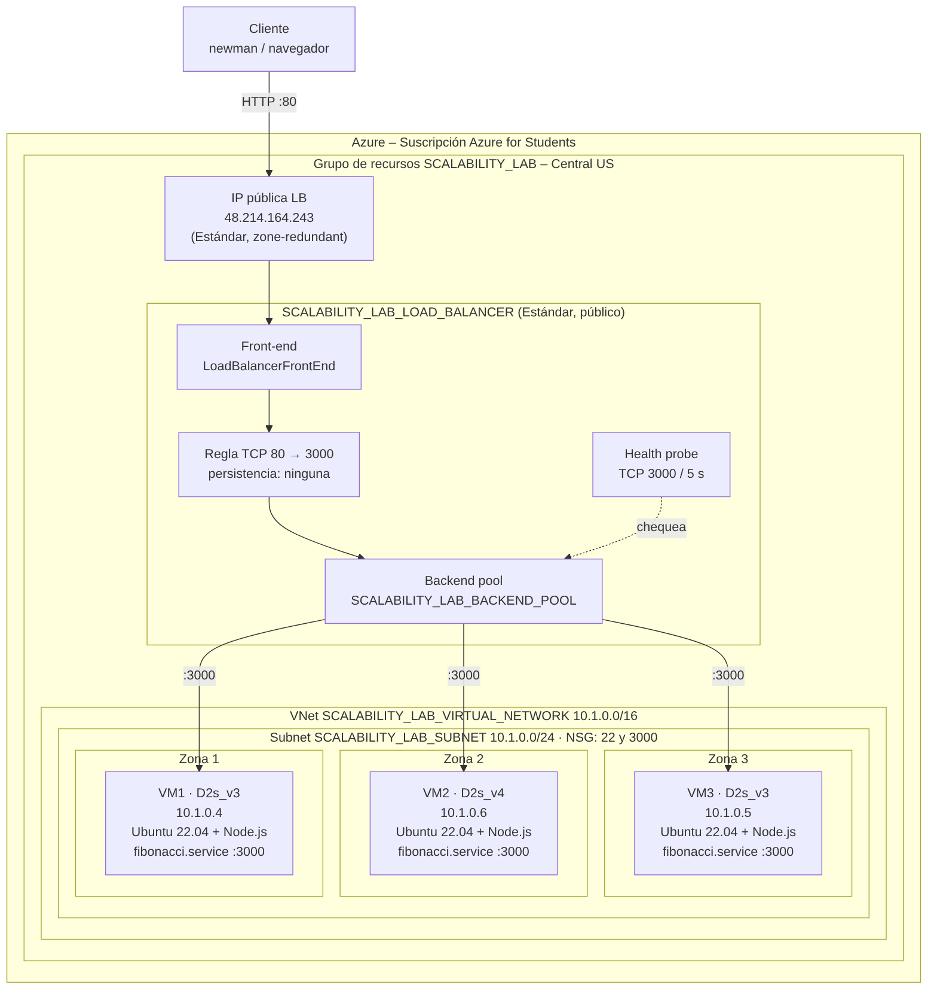

**Explicación del diagrama**

El cliente (newman o el navegador) solo conoce la IP pública del balanceador (`48.214.164.243`, zone-redundant) y le envía las peticiones por HTTP en el puerto 80. Dentro del `SCALABILITY_LAB_LOAD_BALANCER`, el front-end recibe el tráfico y la regla de balanceo lo reenvía al puerto 3000 de alguna de las VMs del backend pool, eligiendo la VM con un hash de 5 tuplas por conexión (sin persistencia de sesión), mientras el health probe revisa cada 5 s por TCP que cada nodo siga respondiendo para no mandarle tráfico a uno caído. Las tres VMs viven en la red privada `SCALABILITY_LAB_VIRTUAL_NETWORK` (`10.1.0.0/16`), dentro de la subred `10.1.0.0/24` protegida por un NSG que solo deja entrar los puertos 22 y 3000, y el LB les habla por sus IPs privadas (por eso VM3 funciona sin IP pública). Cada VM está en una zona de disponibilidad distinta (1, 2 y 3), así que si se cae un datacenter las otras siguen atendiendo, y todas son idénticas: Ubuntu 22.04 con Node.js y la FibonacciApp corriendo como servicio systemd en el puerto 3000, instalada automáticamente con cloud-init. En resumen, hay un único punto de entrada público y varios nodos privados intercambiables detrás, lo que permite escalar horizontalmente con solo agregar otra VM al backend pool, sin que el cliente note el cambio, y además da alta disponibilidad.

### Limpieza

Al terminar las pruebas las VMs se dejan **Detenidas (desasignadas)**, para que no cobren cómputo, y después de la entrega se elimina el grupo de recursos `SCALABILITY_LAB` completo, porque los discos y las IPs públicas siguen cobrando aunque las VMs estén apagadas.